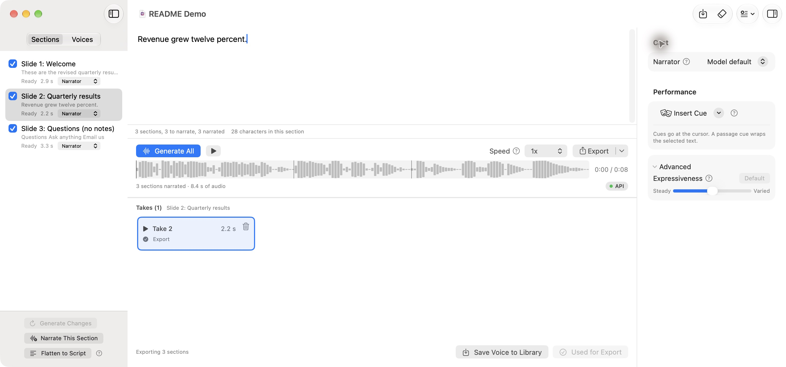
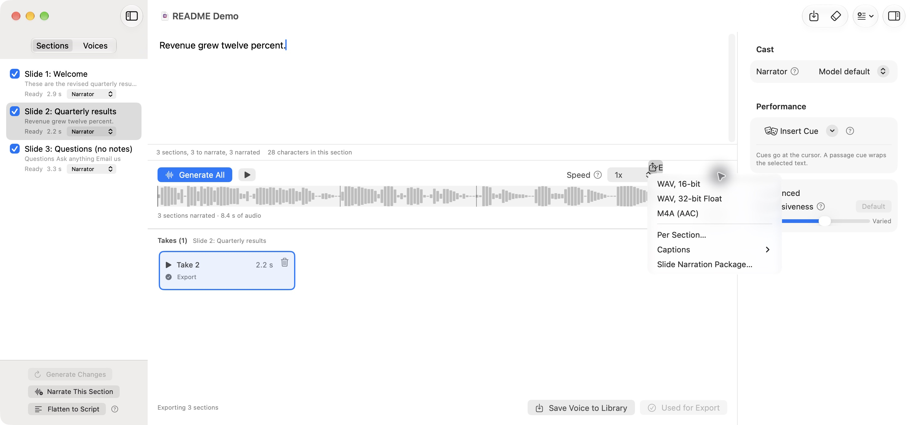
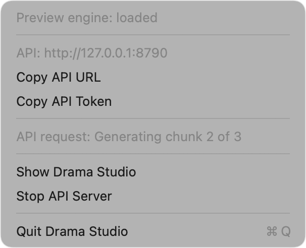

# Drama Studio

[](https://m8ven.ai/mcp/maralski-drama-studio-v1yf5v?s=readme)

By Peter Marelas. A native macOS app that turns scripts into speech locally on
Apple silicon. It runs one of two text-to-speech engines:

- **Ming**: inclusionAI's [Ming-3.0-tts-0.5B](https://huggingface.co/inclusionAI/Ming-3.0-tts-0.5B),
  a 3.0 GB model, through [MingTTS](https://github.com/maralski/ming-tts), a
  Swift and Metal port. The weights are under the MIT License.
- **Drama 3**: Fish Audio's [Drama 3](https://huggingface.co/fishaudio/drama-3),
  a 41.5 GB model with a 35B mixture-of-experts backbone. Its backbone and
  codebook tower run on hand-written Metal compute kernels that read the
  released safetensors weights in place, and its DAC audio codec runs through
  Core ML. The weights are under the
  [Fish Audio Community License](https://huggingface.co/fishaudio/drama-3/blob/main/LICENSE).

Neither engine uses MLX or PyTorch at run time. Clone a voice only with its
owner's consent. The Fish Audio Community License forbids cloning a real
person's voice without it.

https://github.com/user-attachments/assets/273c2a56-71da-4f1f-95a5-c74141b42930

## Which engine to use

**On a low-powered Mac, use Ming instead of Drama 3.** A Mac with less than
64 GB of memory, or less than about 49 GB of free disk, is low-powered for
Drama 3. Ming downloads 3.0 GB, and Drama 3 downloads 43 GB and maps about
41 GB of weights into memory. The setup window recommends Ming on a Mac with
less than 64 GB of memory, and a Ming-only install never downloads Drama 3.

- Use Ming if your Mac has less than 64 GB of memory or little free disk, or
  if you want a short download, no kernel tuning on the first load, and
  faster generation. On the M3 Max below, Ming made about three times as
  much audio per second as Drama 3.
- Use Drama 3 if your Mac has 64 GB of memory or more and you want the most
  expressive speech: any free-form cue such as `[low and menacing]`,
  `<whisper>` passages, director's notes in your own words, take history, and
  the Expressiveness control.

You can install both engines and switch between them. Only one engine is in
memory at a time.

Both engines have run only on one M3 Max with 128 GB of memory. No Mac with
less memory has been tested. Ming states no memory minimum. On the M3 Max its
largest resident size was 5.9 GB, so it is expected to fit on a 16 GB Mac.
That is a guess until someone runs it on one.

| | Ming | Drama 3 |
| --- | --- | --- |
| Model | inclusionAI Ming-3.0-tts-0.5B | Fish Audio Drama 3, 35B mixture of experts |
| Download | 3.0 GB | 41.5 GB of weights and a 1.5 GB codec |
| Memory | No stated minimum; not tested below 128 GB | 64 GB or more recommended; verified only at 128 GB |
| Peak memory on the M3 Max | 5.9 GB resident (3.3 GB footprint) | 43.6 GB resident, mostly file-backed weights (2.3 GB footprint) |
| Load time on the M3 Max | 0.9 to 1.0 s | 2.4 to 2.6 s |
| Speed on the M3 Max, seconds of audio per second | 1.79 (1.25 to 2.48) | 0.56 (0.31 to 0.73) |
| First load | No tuning | Tunes the GPU kernels once, 30 seconds to a minute |
| Performance cues | 14 fixed tags. Common cues map to them; other cues are left out with a notice | Any `[cue]`, as written |
| `<whisper>` and other passage tags | Left out with a notice; the words are spoken plainly | Performed |
| Voice cloning | Yes; clips of up to 15 seconds clone best | Yes |
| Voice design from a description | Yes; uses the description only | Yes; uses the name, description and scene |
| Director's notes | One of five emotions, or a notice | Any note, as written |
| Earlier takes | Give the voice only | Give the voice, and the last two are context |
| Expressiveness control | Ignored, with a notice | 0 to 1 |
| Multi-speaker scripts | Yes | Yes |
| Languages | Chinese, English, Japanese, Korean, German, French, Spanish | Not limited by the engine |
| Weights license | MIT; no agreement asked | Fish Audio Community License 1.0; you agree to its terms first |

All the measurements in the table come from one M3 Max with 128 GB of memory
while other work loaded the machine. Peak memory is the largest resident size
that `/usr/bin/time -l` reported for a `drama serve` process serving one
engine. Drama 3's weights are file-backed memory maps, so most of its 43.6 GB
is pages macOS can drop and read again. Load time runs from process launch
to a loaded model, with the weights already in the page cache. A cold cache
was not measured. Speed is seconds of audio per second of wall time, from
request to response, for a paragraph of about 20 seconds, including the word
check. Each figure is the median of seeds 100 to 104, two rounds each, with
the range in parentheses. Every Ming run completed. Drama 3's figure covers only
the runs that completed before a word-check fix. The others failed because a
recognizer heard "beams sweep" for "beam sweep" and the word check rejected
correct takes. The word check now accepts that difference, and with the fix
the same paragraph passes on Drama 3 for every seed from 100 to 104.

When an engine cannot perform part of a script, it still speaks every word.
The app, the API, `drama-say` and the MCP server report each change as a
notice, such as "Ming can't perform [shouting], so it was left out."
[Cues on each engine](#cues-on-each-engine) lists what Ming performs.

## Install

### System requirements

Both engines need:

- An Apple silicon Mac. Intel Macs are not supported.
- macOS 26 or later. Drama Studio checks every generated sentence with
  on-device speech recognition: the bundled Whisper model, and Apple's speech
  model for the script's language when this Mac has it installed. Without
  Apple's model, Whisper alone checks the words and the take carries a notice.

Ming needs about 3 GB of free disk. A Ming-only install downloads only the
3.0 GB checkpoint. It has no codec download and no tuning step.

Drama 3 needs:

- About 49 GB of free disk: the 41.5 GB download, plus 7 GB that setup keeps
  free for the codec and the packed-weight cache.
- 64 GB or more of unified memory. This is a recommendation, not a verified
  minimum. Generation has been tested on an M3 Max with 128 GB. The engine maps
  about 41 GB of model weights.

Allow more space for generated audio, saved projects and app updates.

### Install the app

1. Download `DramaStudio-<version>.dmg` from the
   [latest release](https://github.com/maralski/drama-studio/releases/latest).
2. Open the disk image and drag Drama Studio to Applications.
3. Open Drama Studio from Applications.

   The release is not notarized, so macOS blocks the first open. Open System
   Settings, go to Privacy & Security, scroll to Security, and click
   **Open Anyway** next to the message about Drama Studio. Confirm with your
   password. If you use Terminal, you can run
   `xattr -dr com.apple.quarantine /Applications/DramaStudio.app` instead.

4. In the setup window's **Choose a speech engine** step, select Ming or
   Drama 3, then click **Continue**. The window marks one engine
   **Recommended for this Mac** and selects it: Ming on a Mac with less than
   64 GB of memory, Drama 3 otherwise. Each row gives the engine's download
   size and license, or "already on this Mac" when its files are present.
5. If you chose Drama 3 on a Mac with less than 64 GB of memory, the window
   shows "This Mac is below what Drama 3 was tested on". Click
   **Choose Another Engine** to go back, or **Continue Anyway**.
6. If you chose Drama 3, read the Fish Audio Community License terms and
   click **I Agree**. Drama 3 does not download and does not speak until you
   agree. Ming's MIT License asks for no agreement, so the Ming path has no
   terms step.
7. Choose **Don't Share** or **Share Usage Information**. See
   [Optional usage information](#optional-usage-information).
8. Wait for the download. The window shows the total, the time left, and the
   progress of each file:
   - for Ming, the Ming-3.0-tts-0.5B checkpoint from Hugging Face, 3.0 GB;
   - for Drama 3, the Drama 3 weights from Hugging Face, 41.5 GB, then the
     Core ML voice codec from the release, 1.5 GB.

   You can pause, or quit and open the app again. The download continues
   where it stopped. Each file is checked against a SHA-256 value that ships
   with the app before it is kept. **Choose Another Engine** stops the
   download, keeps the partial files, and returns to the engine step.
9. For Drama 3, wait 30 seconds to a minute while the first load tunes the GPU
   kernels for your Mac. Ming has no tuning step.
10. Click **Generate** to speak your first line.

If you already downloaded a model with `hf download fishaudio/drama-3` or
`hf download inclusionAI/Ming-3.0-tts-0.5B`, Drama Studio uses that copy and
skips its download. Below 64 GB of memory, Drama 3's row in the engine step
carries this warning, and the same sentence appears again if you choose
Drama 3:

> This Mac has 16 GB of memory. Drama 3 maps about 41 GB of model weights and
> has been verified only on an M3 Max with 128 GB. Below 64 GB, expect very
> slow speech, heavy swapping, or a load that fails.

An install from before Ming that already agreed to the Fish Audio terms
counts as a Drama 3 install and skips the engine step.

### Add or switch engines

To add Ming later, open **Settings > General**, go to the **Ming** section,
and click **Download (3.0 GB)**. **Choose Folder…** uses a checkpoint you
already have. If the folder lacks files, the section lists every missing file.
When the `MING_WEIGHTS` environment variable is set, its folder overrides any
folder chosen in Settings.

To add Drama 3 later, open **Settings > General**, go to the **Drama 3**
section, and click **Set Up Drama 3…**. Until then the section shows
**Not installed**. The main window runs the Drama 3 steps of the setup
window: the low-memory warning when it applies, the terms, the model
download, the codec and the tuning. While those steps run, the app and the
API generate nothing, on either engine. To back out, click
**Choose Another Engine** and choose Ming, which is already on this Mac.

To switch engines, use the **Engine** picker in the Inspector or the Speech
menu. An engine that is not installed shows as "(not installed)", and the
Inspector says "Drama 3 isn't installed. Add it in Settings." beside a
**Settings…** button. The first generation after a switch loads the new
engine and unloads the other one. A retake of an earlier take always runs on
the engine that made that take. When both engines are installed, or a take
came from the engine that is not selected, the take's tile names the engine
that made it.

## Editing scripts

Use **Clear Script** in the toolbar or Script menu to empty the editor.
For an imported document, **Clear Section** empties only the selected section.
Existing takes stay available and may need regeneration after the text changes.
Use Edit > Undo to restore cleared text. Clearing is disabled during generation.

Screenplay Mode requires a speaker name, a colon and a space before dialogue:

```text
Alex: Hello there.
Sam: Good morning.
```

A line without a name continues the previous speaker. Text before the first
named speaker belongs to Narrator. Up to 16 speakers are supported. If the
script has no named dialogue, turn Screenplay Mode off for plain narration,
or use the help button beside the error for the format and examples.

## Cues on each engine

Drama 3 performs any `[bracket cue]` and any `<tag>…</tag>` passage as
written, such as `[low and menacing]` or `<whisper>Quiet now.</whisper>`.

Ming reads 14 fixed tags and one emotion per sentence. Before Ming speaks a
script, Drama Studio rewrites each cue as one of those tags or emotions, or
removes it. `MingCues` in `Sources/DramaEngine/Ming/MingCues.swift` holds the
table. Cues match in any letter case. While Ming is the selected engine,
the **Insert Cue** menu disables each cue Ming can't perform and marks it
"(not on Ming)".

| Typed cue | Ming performs |
| --- | --- |
| `[laughs]`, `[laughing]`, `[laughter]`, `[laugh]`, `[chuckles]`, `[chuckle]`, `[giggles]` | `[Laughter]` |
| `[sighs]`, `[sigh]` | `[Sigh]` |
| `[coughs]`, `[cough]`, `[clears throat]` | `[Cough]` |
| `[breathes]`, `[breathing]`, `[breath]`, `[breathes heavily]`, `[panting]`, `[pants]` | `[Breathing]` |
| `[gasps]`, `[gasp]` | `[Surprise-ah]` |
| `[hesitates]`, `[um]`, `[uhm]` | `[Uhm]` |
| `[hmm]` | `[Dissatisfaction-hnn]` |
| `[with bright eager excitement]` | the happy emotion |
| `[heavy, deflated sadness]` | the sad emotion |
| `[furious, barely holding it together]` | the angry emotion |
| `[breathless and terrified]` | the fearful emotion |

The rest of the rules:

- A cue that starts with a known cue, such as `[laughs nervously]`, is
  performed as the known cue's tag. The notice says so: "Ming performs
  [laughs nervously] as [Laughter]."
- Ming's own tags pass through when you type them exactly: `[Breathing]`,
  `[Cough]`, `[Sigh]`, `[Laughter]`, `[Surprise-ah]`, `[Surprise-oh]`,
  `[Dissatisfaction-hnn]`, `[Uhm]`, `[Confirmation-en]`, `[Question-ei]`,
  `[Question-ah]`, `[Question-en]`, `[Question-oh]` and `[Question-huh]`.
- An emotion cue applies to its sentence and to the sentences after it, until
  the next emotion cue. A sentence takes one emotion. A second emotion cue in
  the same sentence is removed with a notice.
- With a designed voice or the model default voice, Ming speaks the first
  sentence from the voice description or the built-in voice, and that
  sentence cannot take an emotion. An emotion cue in the first sentence gets a
  notice and applies from the second sentence on.
- Any other bracket cue, such as `[shouting]`, is left out with the notice
  "Ming can't perform [shouting], so it was left out."
- Every passage tag, such as `<whisper>`, is removed and its words are
  spoken plainly, with the notice "Ming can't perform <whisper>, so the words
  inside it are spoken plainly."
- When a request clones voices, a `<|speaker:N|>` tag with no voice for
  speaker N uses the last voice given, with the notice "Ming has no voice for
  <|speaker:N|>, so those lines use the last voice."

A director's note on Ming becomes an emotion when it contains one of these
words. Otherwise the note is not used, and gets the notice "The note "…"
names no emotion Ming performs, so it was not used." A note's emotion
overrides emotion cues in the script. When a retake will run on Ming, the
note suggestions under the takes are the five emotions, with the caption
"Ming takes one emotion from a note: happy, sad, angry, fearful or
surprised."

| Emotion | Words in a note |
| --- | --- |
| happy | happy, happier, cheerful, excited, joyful |
| sad | sad, sadder, sorrowful, mournful |
| angry | angry, angrier, furious, enraged |
| fearful | scared, afraid, terrified, fearful, frightened |
| surprised | surprised, astonished, shocked |

## Voices, takes and languages on each engine

Both engines clone a voice from a clip and its transcript, design a voice from
a description, and voice up to 16 speakers. A library voice works on both
engines. The first time an engine uses a voice, Drama Studio encodes the
voice's clip for that engine and saves the encoding with the voice.

On Ming:

- Clips of 5 to 15 seconds clone best. Ming encodes the whole clip, so a
  longer clip leaves less room to speak each line. **Add Voice** warns about a
  clip over 15 seconds but does not refuse it. For Drama 3 the advice is 5 to
  20 seconds.
- A designed voice uses the description only. The character's name and scene
  are not used.
- The model default voice is Ming's built-in `US_Emma` voice.
- Earlier takes of a line give the voice only. Ming clones the opening
  sentences, up to 10 seconds, of the line's first take. It does not continue
  the last two takes as context, the way Drama 3 does.
- Expressiveness has no effect. Drama Studio passes no sampling settings to
  Ming. The Inspector disables the slider and says "Ming ignores
  Expressiveness. Switch to an engine that uses it to change it." An API
  request that sets `expressiveness` to anything but the default gets the
  notice "Ming ignores the Expressiveness setting."
- Ming speaks Chinese, English, Japanese, Korean, German, French and Spanish.
  A script in another language, or an API request whose `language` names
  another language, fails before generation with an error such as
  "Ming can't speak Italian; it speaks Chinese, English, Japanese, Korean,
  German, French, and Spanish". The API returns it with `400`, except on the
  live route, which reports it in an `error` event.
  MingTTS spells out numbers, dates, currencies and units in English text
  only. It does not normalize Chinese text.
- A voice saved before voices kept their recording has only Drama 3 codes,
  which only Drama 3's voice codec can turn back into a clip. Until Drama 3
  is set up, using that voice on Ming fails with "The voice … was saved without
  its recording, and only Drama 3's voice codec can recreate it. Set up
  Drama 3 in Settings, or add the voice again from a recording."

Drama 3 has no language list of its own. On either engine, the word check
hears each sentence with the bundled Whisper model and, when this Mac has one
installed for the script's language, with Apple's speech model too. Apple
installs its speech models one language at a time. In a language without
one, Whisper alone checks the words and the take carries the notice "This Mac
has no Apple speech model for Spanish, so only Whisper checked the words."
Drama Studio never downloads Apple's speech models. A language Whisper does not
know, such as Cherokee, fails with "Cannot check the generated words: Drama
Studio's speech recognizer doesn't know Cherokee, so it can't check words in
it." (`400` from the API).

The check compares words with each language's own rules. Spanish, French,
Italian and Catalan ignore accents, which recognizers write either way for the
same sound ("si" and "sí"), but "ñ" still differs from "n". German spells
out umlauts, so "schön" matches "schoen" and never "schon", and "ß" matches
"ss". Chinese and Japanese compare character by character, whatever the word
breaks, with traditional and simplified Chinese as one, and katakana and
hiragana as one. The English rules for numbers, contractions such as
"wanna", spellings, homophones and a shared final s apply only to English.

Each request is spoken and checked in one language. An API request can name
it in `language`, and the engine uses that language instead of detecting one.
Otherwise the engine tells the language from the text. A
line it cannot tell is read in your macOS language, if the text is in a
script that language uses. A line cannot be told when the language
recognizer is uncertain, or when the line has fewer than four words and the
recognizer is less than 0.95 sure. So "Hi." and "Goodbye." are read in
English on an English Mac, and "こんにちは。" is still read in Japanese. In a
live session, a sentence that cannot be told takes the language of the
sentence before it. The app passes no language and relies on this fallback.

## Troubleshooting

- **An engine shows as "(not installed)".** Open **Settings** and read the
  engine's status, or run `drama setup` from a source build. Each missing file
  is listed with its fix.
- **Drama 3 is slow, swaps, or fails to load on a Mac with less than 64 GB.**
  Switch to Ming in the Inspector. If Ming is not installed, add it from
  **Settings > General > Ming**.
- **A cue or note had no effect.** The engine could not perform it. The app
  shows the notice in a banner you can dismiss, and the take's tile counts its
  notices ("1 notice"). `drama-say` prints each notice on standard error, the
  MCP tools return them, and the API returns them in `X-Drama-Notices`.
  [Cues on each engine](#cues-on-each-engine) lists what Ming performs.
- **"Ming can't speak …; it speaks …".** The script, or the API request's
  `language`, is in a language Ming does not speak. Switch to Drama 3, or use
  Chinese, English, Japanese, Korean, German, French or Spanish. If the line
  is short and the engine named the wrong language, send the right one in the
  API's `language` field.
- **"This Mac has no Apple speech model for …, so only Whisper checked the
  words."** The take was checked by one recognizer instead of two. Nothing is
  wrong with it. Apple installs its speech models one language at a time, and
  Drama Studio does not download them.
- **"Cannot check the generated words: the script's language is uncertain;
  use a complete sentence".** The engine could not tell the line's language,
  and the line is not in a script your macOS language uses. Through the API,
  send the language in `language`. In the app, write a complete sentence.
- **"The voice … was saved without its recording".** The voice predates
  saved clips and needs Drama 3's codec. Set up Drama 3 in **Settings**, or
  add the voice again from a recording.
- **Generation stops with "Drama Studio is still setting up" or "Drama
  Studio won't generate speech until you agree".** The setup window is
  running, for example after **Set Up Drama 3…** in Settings. The app and the
  API (`403`) refuse every request, on either engine, until setup finishes or
  you click **Choose Another Engine** and choose an engine that is already
  installed.
- **The API answers `400` and lists the installed engines.** The request's
  `model` names an engine that does not exist ("No engine is called …") or
  is not installed ("… isn't installed on this server"). `GET /v1/models`
  lists the installed engines.
- **The first request after a switch takes longer.** The new engine loads,
  and the other engine unloads, before it speaks.

## App updates

Drama Studio checks GitHub for a newer stable release at launch and downloads
it in the background. Automatic checks and downloads are on by default. Turn
them off in **Settings > Updates**, or use **Drama Studio > Check for Updates**
to check manually at any time.

Once the download is verified, **Settings > Updates** offers **Install and
Restart**. Save your project and finish generation or API requests before
confirming. **Later** leaves the running app unchanged; click **Review Update**
in Settings > Updates when ready. Check for Updates opens the same tab.
There is no separate Software Update window. Quitting normally does not install
an update. A deferred update is downloaded again on the next automatic or manual check.

Updates require the app to be installed in a folder you can write to, such as
Applications or your user's Applications folder. Apps running from a mounted
DMG, App Translocation, or a Swift build directory cannot update themselves.
The updater changes only the app bundle; models, voices, and projects stay in
place. It uses the release's `DramaStudio-<version>.dmg` and `SHA256SUMS`, checks
the bundle identity, version, and minimum macOS requirement, verifies its code
signature, and requires the
same signing identity for Developer ID builds. Ad-hoc builds rely on GitHub
HTTPS and the published checksum for authenticity.

After restart, setup compares the installed codec's recorded archive SHA-256
with the digest shipped in the updated app. Matching codecs are reused even
when the release URL changes. A changed digest or missing codec models triggers
a verified download and installation.

## What you get

- **Script editor** with import of `.txt`, `.md`, `.rtf`, `.rtfd`, `.html`,
  `.docx`, `.srt` and `.vtt`, drag and drop, and a screenplay mode that turns
  `Name: line` dialogue into speaker tags (up to 16 speakers).
- **Two engines**, Ming and Drama 3, picked in the Inspector or the Speech
  menu (see [Which engine to use](#which-engine-to-use)).
- **Takes**: Generate or Generate All produces a fresh take each time. A
  scrolling grid shows take durations, notes, export choices and outdated audio.
  The status line gives the selected take's numbers, such as "4.2 s of audio ·
  1.8x real time · generated in 2.3 s". The speed is that take's audio over
  its wall time, with model loading and the word check included.
  Other controls include an Expressiveness slider under Advanced (on Drama 3,
  one control over temperature, top-p and top-k, with the vendor's defaults in
  the middle and the Hugging Face Space's sampling at the top; on Ming it is
  disabled), and an insert menu for performance cues such as `[laughs]`, `[sighs]`
  and `<whisper>…</whisper>` (see [Cues on each engine](#cues-on-each-engine)). Each chunk's frame cap follows the length of its text.
  Normal generation checks each decoded sentence with local, audio-only speech
  recognition before playback or reuse as history. It also checks each complete
  adjacent pair before releasing the next sentence, so a bad join retries only
  the unplayed sentence within the same attempt limit. Each raw sentence must
  pass both recognizers with the existing native confidence checks. For a pair
  of those exact verified sentences, the native checker may mark only the first
  nonterminal word of the second sentence uncertain while both full transcripts
  still match. That narrow boundary case uses the raw sentence's confidence;
  ambiguous word positions, missing confidence, or other uncertain words fail.
  Arbitrary-file checks have no such generated-sentence evidence. These bounded windows
  cover every generated join within one request; they do not establish a global
  transcript for a long recording or certify joins between separate requests. Missing or uncertain words
  trigger a bounded retry; exhaustion fails instead of creating a completed take.
  Checked generation requires macOS 26 and the bundled independent recognizer.
  When this Mac has Apple's on-device speech model for the script's language,
  both audio-only recognizers must find every scripted word before a sentence
  is accepted; without it, the independent recognizer alone must, and the take
  says so in a notice. A disagreement retries generation; an unavailable checker stops
  generation. These checks reduce word errors but cannot guarantee recognition
  accuracy or acting quality.
  Voice auditions always use checked generation.
  Recognition checks word coverage, not acting quality or perfect cue execution.
- **Document narration**: a PowerPoint deck, a PDF or an EPUB opens as
  sections, one per slide, page or chapter, and narrates section by section
  with the same voice throughout. Exports are the whole narration, one file
  per section with a `manifest.csv`, SRT or WebVTT captions, and for a deck a
  slide narration package. Projects save and reopen as `.dramaproj` bundles
  (see [Documents](#documents)).
- **Pronunciation rules** in Settings rewrite words before the model hears
  them, in the app and through the API.
- **Voice cloning** from one or more reference clips (any format AVFoundation
  reads) plus their transcripts, kept in a local voice library that both
  engines share. On Ming, use clips of 15 seconds or less.
  To reuse a generated voice, select a take and click **Save Voice to Library**
  beside **Use for Export**. Name the voice and save it. The app selects it for
  future generations, including after you edit the script. This works with
  Model default takes and individual document sections. Complete takes that
  passed the current word check and contain one speaker can be saved; outdated
  script text does not prevent it.
  **Save Session Voice** in Cast saves the retained session voice instead.
- **Streaming playback** as chunks finish, scrubbing, a speed control from
  0.75x to 1.5x, the sentence being spoken highlighted in the editor, and
  export to WAV or M4A.
- **A local HTTP API and an MCP server**, so scripts and agents can speak
  through the same engine and voice library (see
  [Agents and programs](#agents-and-programs)).
- **Menu bar residency**: closing the window leaves Drama Studio in the menu
  bar (the app icon's waveform) with the API still serving. The menu
  shows the model state, the API address, and the current job. ⌘Q quits.

## Build requirements

The [system requirements](#system-requirements) also apply to source builds.
Install the following tools, then the files of at least one engine:

- macOS 15 or newer, Xcode 26 command line tools.
- [MingTTS](https://github.com/maralski/ming-tts), the Swift and Metal port
  of Ming-3.0-tts. SwiftPM fetches it at `0.1.0`. To build against a local
  checkout instead, set `MING_PACKAGE_PATH` to its folder.

For Ming, put the 3.0 GB checkpoint in the Hugging Face cache:

```bash
uvx --from huggingface_hub hf download inclusionAI/Ming-3.0-tts-0.5B
```

To use a checkpoint in another folder, set `MING_WEIGHTS` to the folder that
holds `model.safetensors`, `config.json`, `tokenizer.json` and
`campplus.onnx`. The app's **Settings > Ming** can also download the pinned
revision.

For Drama 3, install these files:

- The model in the Hugging Face cache:

```bash
uvx --from huggingface_hub hf download fishaudio/drama-3
```

- The Core ML codec models, built once from `codec.pth`:

```bash
cd tools && uv venv --python 3.12 .venv && uv pip install --python .venv/bin/python "torch==2.7.1" coremltools "numpy<2.4" einops soundfile
.venv/bin/python -I ../Sources/DramaEngine/CodecConversion/convert_codec.py
```

  They land in `~/Library/Application Support/DramaStudio/Codec/` (encoder
  809 MB in fp32, decoder 353 MB and the 64-frame silence-probe decoder
  352 MB in fp16).

`drama setup` reports what each engine has and lacks, with a fix for each
gap.

## Build and run

```bash
python3 tools/bootstrap_word_recognition.py  # downloads and checks pinned framework and local speech models
swift build -c release
python3 tools/stage_word_recognition.py --bin .build/release
tools/make_app.sh            # assembles dist/DramaStudio.app, with drama-mcp and drama-say in Contents/MacOS
open dist/DramaStudio.app
```

Command line:

The app build stages the recognition runtime automatically. CLI builds and tests
need the bootstrap and staging steps above. The English and multilingual models
use about 975 MB on disk; recognition runs locally with no script hints. English
uses `small.en`; other supported languages use `small`. Only the selected model
is loaded. Recognition requires both an installed Apple model and a supported
independent model language.

Run the retained wrong-word and complete-ending controls with
`swift test -c release --filter LocalWordVerifierTests`. On macOS 26 these controls
fail if required local assets are missing; they do not skip that failure.

`tools/make_cli.sh` assembles a signed, relocatable CLI runtime in
`dist/drama-cli`, including the helper, framework, resource bundle, models and
licenses. Set `DS_VERIFY_NATIVE_WORD_CHECKS=1` when running either packaging
script to require the installed native model and exercise the full dual check
on the retained complete-ending and wrong-word recordings. Packaging always
tests the independent runtime. The full offline check can also be rerun with
`drama check-words <WAV> <script> <accepted|rejected>`, or with the app executable's
`--check-words` flag. These commands do not load the speech generation model.

```bash
.build/release/drama tune                      # once per Mac, about 30 s; the app does it on first load
.build/release/drama generate --text "Hello there." --out frames.npy
.build/release/drama bench                     # add --untuned to compare against the hand-written schedule
.build/release/drama setup                     # what each engine's install has and lacks, with the fixes; --model <dir>, --ming-weights <dir>
.build/release/drama serve                     # the HTTP API without the app; --port 8780, --no-token, --engine drama3|ming, --model <dir>, --ming-weights <dir>, --voices <dir>
.build/release/drama-say "Hello there."         # speaks through the running app, like say; see From the terminal
```

`drama setup` exits with 1 when no engine is ready. It finds Ming in
`MING_WEIGHTS`, then in the Hugging Face cache, and Drama 3 in the Hugging
Face cache. `--ming-weights` and `--model` name other folders. Neither command
looks in the app's own download folder.

`drama serve` serves every installed engine. `--engine`, else the
`DRAMA_ENGINE` environment variable, picks the engine that requests use when
they name none. Without either, Drama 3 is the default when it is installed.
It prints which engines it serves, and names on standard error an engine it
cannot serve and why.

`DRAMA_PREVIEW_ENGINE=1` runs the app or `drama serve` on mock engines that
produce placeholder tones, one for each engine, for working on everything but
the models. `DRAMA_ENGINE=ming` also makes the app start on Ming.

The app looks for the weights in this order: the folder chosen in Settings,
its own download in `~/Library/Application Support/DramaStudio/Models/drama-3-e0a9218/`,
then the newest Hugging Face cache snapshot (`HF_HUB_CACHE` or `HF_HOME` move
it). Ming is found the same way, after `MING_WEIGHTS`, with its download in
`Models/Ming-3.0-tts-0.5B-7247f4c/`. The Inspector and the Speech menu pick
the engine; one without its files shows as not installed. A build from `tools/make_app.sh`
has no codec download, so its setup window shows the Python conversion command
above when the codec models are missing; `tools/make_release.sh` builds the
release DMG and the codec zip and writes the zip's URL and SHA-256 into the
app. `DRAMA_STUDIO_HOME=<folder>` moves the downloads, the codec, the tuning,
the settings and the API token into one folder and ignores the Hugging Face cache, to try a
first run without touching your own. `DRAMA_STUDIO_MEMORY_GB=16` makes setup
treat the Mac as a 16 GB Mac, so the engine step recommends and selects Ming
and shows the low-memory warning under Drama 3. It changes only what setup
shows, not the memory an engine can use. `tools/pin_model_plan.py --check`
compares the pinned download plan with Hugging Face.

## Documents

Importing a `.pptx`, `.pdf` or `.epub` (File > Import Script or Document,
drag and drop, or opening the file with the app) opens it as sections: a
deck's slides, with the speaker notes as the text and the slide text when a
slide has no notes; a PDF's pages; an EPUB's chapters. The list shows each
section's label, a preview, its duration once narrated, a skip box and a
speaker picker. The editor edits the selected section.



- Generate narrates every section that is not skipped, in order, one request
  per section, cast with that section's speaker's voice. The speaker's
  previous section goes along as history, and with no library voice cast
  the speaker's first narrated section is also the voice, the way takes and
  the live route already carry a voice. Narrate This Section
  generates one section again. Click a take to audition it, then click
  **Use for Export** to choose it for the narration. The Export badge identifies
  the chosen take; auditioning another take does not change it.
- Editing text or changing a speaker or voice marks the affected audio as
  **Needs regeneration**. **Generate Changed Sections** updates only missing
  or outdated sections. Export asks before writing outdated or incomplete audio.
  Earlier takes remain available, including after a project is reopened.
- Export writes the whole narration, Per Section (numbered files and a
  `manifest.csv`), Captions as SRT or WebVTT, timed from the audio each
  sentence took, and for a deck a Slide Narration Package: `slide-NN.wav` per
  narrated slide and a `README.txt` on adding them with Insert > Audio. The
  app does not change the deck.
- **Save Project** writes a `.dramaproj` bundle with the document or script,
  settings, voice assignments, session voices, and every take with its original
  text, voice assignments, engine context, and audio. Library assignments still refer to
  voices in the local library. Save updates the current project; **Save Project
  As** creates a copy.
- Import, Open Project, and Quit offer Save, Discard Changes, or Cancel when
  work is unsaved. A failed or cancelled save leaves the current session open.
  After editing pauses for two seconds, the app writes a recovery draft in the
  background; drafts wait until generation stops. The next launch offers to
  restore a draft left by an interrupted session. Recovery does not replace
  the last manually saved project.
- **Flatten to Script** turns the sections into one plain script and removes
  their takes from the session. Its confirmation offers to save a project copy
  first.



Document sections always generate in sentence mode, whatever "Stream audio
while generating" says, so playback of a section starts when the section is
done.

## Reliability

`eval/reliability/REPORT.md` is a 330-run study of whether Drama 3 speaks
every sentence: 33 conditions (short and long lines, numbers,
abbreviations, all caps, performance cues, multi-speaker tags, Spanish,
French and German, a cloned voice, both expressiveness extremes, and two
control conditions), five seeds each, in `full` and `balanced`. It was run on
2026-10-18 and predates the current defaults: no silence stop, short sentences
kept as separate turns, up to five retries, and a required word check on every
sentence (see [Streaming](#streaming)). Treat its numbers as a record of that
build, not a measurement of this one.

| rows | full | balanced |
| --- | --- | --- |
| plain prose under the 2026-10-18 defaults | 130 of 130 | 126 of 130 |
| performance-cue lines | 16 of 20 | 14 of 20 |
| retries off (control) | 1 of 5 | 3 of 5 |
| reference 300-byte chunking (control) | 7 of 10 | 9 of 10 |

Paired by seed, balanced is never right where full is wrong, and wrong where
full is right in 4 of 130 prose pairs. Performance cues are the one area
where both modes drop content a few times in twenty; `[laughs]` can also turn
into a laughter loop that the app's text-derived frame cap ends near 8 s.
Reproduce with `eval/reliability.py` (slices under `eval/reliability/slices/`).
The `balanced` mode was removed after this study, so the engine has one
precision, `full`; the column stays as the record of why.

The cue dropouts were then investigated on eight cue lines, five seeds each,
eleven variants (`eval/cues/`, section "Performance cues: investigation" of
the report). The model stops at a cue that follows a sentence end, whatever
the chunking; longer chunks lose more. Three guards now ship: a laughter loop
is detected in the code stream (the main tokens cycle with a period of 17 or
more, which the 16-frame repetition redraw forces) and the chunk is
regenerated; a chunk that stops without eos is regenerated when it spoke
under its expected duration; and the frame cap grows by 1.5 s per `[cue]` so
a laugh or a pause is not cut off. Every sentence present went from 44 of 55
runs to 38 of 40 on the cue lines; on six prose lines at five seeds the
old and new rules score 30 of 30 and 29 of 30, the one difference being a
line that both rules retry and where the new rule's random path lost. The
Space's sampling (temperature 1.0, top-p 0.9, top-k off) was then run over
the whole study (section "The Space's sampling on prose"): no prose row
lost in 130, every sentence of the 20 cue lines, 5 retries instead of 19,
the two-sentence line reaching the end of speech on its first attempt with
retries off in 5 of 5, and 0.007 more word error rate on prose (standard
error 0.004), mostly abbreviations and a few slurred words. It is the top of
the Expressiveness slider and the API's `expressiveness: 1`; the vendor's
sampling stays the default. Since then every sentence also passes a local
word check before release, so a dropped clause is retried or fails the
request instead of reaching a finished take. The Insert Cue menu still says to
listen before export to judge the performance.

For Ming, `Tests/DramaStudioTests/MingReliabilityHarness.swift` runs a fixed
corpus of six voices, eight lines and three seeds through the engine registry
the app uses. It prints the first-attempt word-check pass rate, hard
failures, mean attempts and the real-time factor. Its header has the command.

## Agents and programs

While Drama Studio is open, including when only its menu bar icon is left, it
serves an HTTP API on `http://127.0.0.1:8780`. `drama serve` serves the same
API without the app. The API listens on the loopback interface only. Settings
holds the port, a switch for starting the server with the app, and the token.
The menu bar has Start and Stop. When the port is taken, the menu shows
"API: Port 8780 is already in use."



Every route except `/v1/health` needs the bearer token from
`~/Library/Application Support/DramaStudio/api-token`, or from `api-token` in
`DRAMA_STUDIO_HOME` when that is set, created the first time the server
starts. A `401` answer names the token file the server uses. The token keeps web pages, which can reach localhost, from
driving the engine. `drama serve --no-token` turns it off.

```bash
TOKEN=$(cat ~/Library/Application\ Support/DramaStudio/api-token)
AUTH="Authorization: Bearer $TOKEN"
```

The speech request follows the
[SGLang Drama 3 cookbook](https://sgl-project.github.io/sglang-omni/cookbook/fishaudio_drama3.html):

| Route | Does |
| --- | --- |
| `GET /v1/health` | `{status, model_loaded, engine: "metal" or "mock", speech_engine: "drama3" or "ming", busy, tuned, version}`. `speech_engine` is the engine requests use when they name none. `tuned` is `null` until the selected engine loads its model, then whether Drama 3's kernels are tuned; Ming and the mock engines report `false`. `model_loaded` and `tuned` describe the selected engine. After a request runs on the other engine, they read `false` and `null` while that engine is loaded. While a generation runs it adds `estimate: {elapsed_seconds, remaining_seconds, frames_done, frames_expected}`; `remaining_seconds` is `null` once the last sentence is in its silence tail or a retry runs. |
| `GET /v1/models` | One entry per installed engine: `{id, engine, name, snapshot, mock, selected}`, with `id` the Hugging Face model id, such as `fishaudio/drama-3` or `inclusionAI/Ming-3.0-tts-0.5B`. |
| `POST /v1/audio/speech` | Speaks `input`. Returns the audio file, or a PCM stream. |
| `POST /v1/tts` | The same, with the text in `text`. |
| `GET /v1/audio/speech/stream` | Speaks the `input` query parameter as Server-Sent Events. See [Streaming](#streaming-framing). |
| `POST /v1/audio/speech/live` | Speaks text while the client is still sending it, and streams the audio back on the same connection. See [Streaming](#streaming-framing). |
| `GET /v1/voices` | The voice library: id, name, transcript, seconds, source file. |
| `POST /v1/voices` | Clones a voice: JSON `{name, transcript, audio_base64 or audio_path}`, or multipart with a `file` part plus `name` and `transcript` fields. |
| `DELETE /v1/voices/{id}` | Deletes a voice. |
| `GET /v1/takes/{id}` | One of the last 20 takes: `{id, engine, input, text, seconds, samples, previous_take_ids}`, plus `frames` and `codes_base64` for a Drama 3 take. |

The speech body takes these fields:

| Field | Meaning |
| --- | --- |
| `input` | The text. Performance cues such as `[laughs]` and `<\|speaker:1\|>` tags work as in the app, and Ming rewrites or removes cues as [Cues on each engine](#cues-on-each-engine) describes. |
| `voice` | A library voice, by id or name. |
| `references` | Clips to clone on the fly: `[{audio_path or audio_base64, text}]`. |
| `speaker_voices` | Library voices per speaker for a multi-speaker script: `{"0": "Narrator", "1": "<id>"}`, with no gaps from speaker 0. |
| `response_format` | `wav` (default, 16-bit), `pcm` (raw 16-bit little-endian), or `m4a`. |
| `stream` | `true` streams completed, checked chunks. |
| `expressiveness` | 0 to 1, default 0.5: the app's Expressiveness slider. 0.5 is the vendor's sampling, 1 the Hugging Face Space's. Drama 3 only. Ming ignores it, with a notice when the value is not the default. |
| `seed` | A fixed sampler seed, for repeatable takes. |
| `character` | A voice designed from a description instead of a clip: `{name, description, scene?}`. Ming uses only `description`. |
| `note` | A director's note, such as `"softer and warmer"`. On Drama 3, the line is generated again, sentence by sentence, with the note as a direction and as a cue before every sentence. On Ming, a note that names an emotion sets that emotion, and any other note gets a notice. |
| `previous_takes` | Earlier takes of the line, oldest first: `[{take_id}]`, or `[{text, codes_base64}]` for a Drama 3 take. With no `voice` or `references`, the first one is the voice. On Drama 3, the last two are also context. A take from the other engine gets a notice and is not used. |
| `model` | The engine to speak with: its id (`drama3`, `ming`), model id or name. Without it, a request that continues a cached take runs on that take's engine, and any other runs on the selected one. OpenAI's model names, `tts-1`, `tts-1-hd` and `gpt-4o-mini-tts`, are treated as no model, so OpenAI clients work unchanged. Any other name, and an engine that isn't installed, gets `400` listing the installed engine ids. Only one engine is loaded at a time, so a request for the other engine unloads the current one first. |
| `language` | The language of `input`, as a BCP 47 code such as `en`, `fr` or `zh-Hans`. The engine speaks and checks the text in that language and does not tell the language from the text. A wrong code fails the word check. A value that is not a language code gets `400`, and on Ming, a language Ming does not speak gets `400`. Without it, the engine tells the language from the text, and reads a line too short to tell in your macOS language, as [Voices, takes and languages on each engine](#voices-takes-and-languages-on-each-engine) describes. |
| `apply_pronunciation` | `true` (default) rewrites `input` with the pronunciation rules in `~/Library/Application Support/DramaStudio/pronunciation.json`, the same rules the app uses, before it is spoken; `false` speaks it as sent. |

A request takes at most one of `voice`, `references`, `speaker_voices`, and
`character`. Every generation is a take: the response carries its id in
`X-Drama-Take-Id`, and the server keeps the last 20. A `take_id` in
`previous_takes` also brings the takes that take was made after, so naming a
line's latest take carries its first take, the voice. Leave out `input` to
retake the line of the last named take, with its voice and character.
`codes_base64` is the take's codes as 16-bit little-endian integers, codebook
by codebook, as `GET /v1/takes/{id}` returns them.

Every speech response names the engine that made it in `X-Drama-Engine` and
`X-Drama-Model`, and the `done` event carries `engine`. A file response
carries `X-Drama-Samples`, `X-Drama-Seconds`, `X-Drama-Generation-Seconds`,
`X-Drama-Word-Coverage` (`recognized` or `unchecked`) and
`X-Drama-Verification-Seconds`. A Drama 3 response also carries
`X-Drama-Frames` and `X-Drama-Generated-Frames` (including rejected
attempts). When the engine cannot perform part of the request as written,
such as a cue Ming has no tag for, `X-Drama-Notices` holds a JSON array of
one-sentence messages; the words are still spoken. The same header carries
the notice that only Whisper checked the words, in a language this Mac has no
Apple speech model for. A sentence that still fails the word check
after its retries, or a missing word checker, fails the request with `500`
and a plain-text message. A script whose language the check cannot hear (it
mixes languages, its language is uncertain, or Whisper does not know it) fails
with `400`. The engine runs one generation at a time. A
request that arrives while another runs, through the API or in the window, gets
`429` with `Retry-After`. A bad request gets `400` with a plain-text message
that names the field.

```bash
curl -sS localhost:8780/v1/health
curl -sS -H "$AUTH" localhost:8780/v1/audio/speech \
  -d '{"input": "Hello there. [laughs] Good to see you.", "voice": "Narrator"}' -o hello.wav
curl -sS -H "$AUTH" localhost:8780/v1/tts -d '{"text": "The alias route."}' -o alias.wav
curl -sS -H "$AUTH" localhost:8780/v1/audio/speech \
  -d '{"input": "Cloned on the fly.", "references": [{"audio_path": "/path/to/clip.wav", "text": "What the clip says."}]}' -o clone.wav
curl -sS -H "$AUTH" -D headers.txt localhost:8780/v1/audio/speech \
  -d '{"input": "[low and menacing] Pray ye never find out.", "character": {"name": "Captain", "description": "gravelly old male voice, weathered and slow"}}' -o captain.wav
TAKE=$(awk 'tolower($1) == "x-drama-take-id:" {print $2}' headers.txt | tr -d '\r')
curl -sS -H "$AUTH" localhost:8780/v1/audio/speech \
  -d "{\"note\": \"softer and warmer\", \"previous_takes\": [{\"take_id\": \"$TAKE\"}]}" -o captain-retake.wav
curl -sS -H "$AUTH" localhost:8780/v1/models
curl -sS -H "$AUTH" -D ming-headers.txt localhost:8780/v1/audio/speech \
  -d '{"input": "Hello there. [laughs] <whisper>Quiet now.</whisper>", "model": "ming"}' -o ming.wav
grep -i '^x-drama-notices' ming-headers.txt
```

The last request speaks on Ming. Ming performs `[laughs]` as `[Laughter]` and
cannot whisper, so `X-Drama-Notices` holds
`["Ming can't perform <whisper>, so the words inside it are spoken plainly."]`.

### Streaming framing

All three streaming routes send only completed chunks. The engine checks each
sentence's words before releasing its audio, so a rejected attempt can be
replaced for any voice.

The audio is always 16-bit little-endian mono at 44.1 kHz, as the
`X-Drama-Format: pcm_s16le_mono` and `X-Drama-Sample-Rate: 44100` headers say.
`stream: true` and the event stream also send `X-Drama-Take-Id`,
`X-Drama-Estimated-Seconds` and any `X-Drama-Notices` before the first audio.

**PCM.** `stream: true` on `POST /v1/audio/speech` answers with
`Transfer-Encoding: chunked` and raw PCM in the HTTP chunks. A chunk boundary
means nothing; concatenate the chunks. Every chunk holds whole 16-bit
samples. On Drama 3 it also holds whole 2048-sample frames. Raw PCM has no
way to report an error, so a stream that fails after its headers are sent
ends without the zero-length chunk that completes a chunked body. curl then
reports "transfer closed with outstanding read data remaining" and exits with
code 18. Pipe the stream into a player:

```bash
curl -sSN -H "$AUTH" localhost:8780/v1/audio/speech \
  -d '{"input": "A long script, read as it is generated.", "stream": true, "response_format": "pcm"}' |
  ffplay -f s16le -ar 44100 -ch_layout mono -nodisp -autoexit -
```

**Server-Sent Events.** `GET /v1/audio/speech/stream` takes its fields as query
parameters: `input` (required), `voice`, `model`, `language`, `expressiveness`,
`seed`, and `character_name`, `character_description` and `character_scene`
for a designed voice. `apply_pronunciation=false` turns off the pronunciation
rules, as in the speech body. It answers with `Content-Type: text/event-stream`
and these events:

| Event | `data` |
| --- | --- |
| `audio` | Base64 of the next PCM bytes: whole samples, and on Drama 3 whole frames. |
| `sentence` | `{"index", "text", "seconds"}` after the last audio of each sentence. |
| `done` | `{"take_id", "engine", "samples", "word_coverage", "seconds"}` once the take is complete, plus `frames` for a Drama 3 take, with `notices`, an array of messages, when the engine could not perform part of the request. |
| `error` | `{"message"}`. The stream then ends as a complete chunked body. |

The route still needs the bearer token, and the server sends no CORS headers,
so a browser's `EventSource`, which cannot send an `Authorization` header, does
not work with the token on. Read the events with `fetch` and a stream reader
from a page the server already trusts, or with any HTTP client.

```bash
curl -sSN -H "$AUTH" "localhost:8780/v1/audio/speech/stream?input=Hello%20there.%20Good%20to%20see%20you."
```

**Live text input.** `POST /v1/audio/speech/live` is for an agent that writes
text a piece at a time. It takes `voice`, `model`, `language`, `expressiveness`,
`seed` and the `character_*` fields as query parameters, and the text as the
request body:

- Send the body with `Transfer-Encoding: chunked`, or with a `Content-Length`
  that covers everything you will send. The server reads it as it arrives.
- The body is UTF-8 text in lines ended by `\n` (or `\r\n`). The server acts
  on a line once its newline arrives.
- The server joins the lines with spaces and speaks each sentence once a
  sentence end (`.`, `!`, `?`, `;`, `…`, or a CJK one, optionally followed by a
  closing quote or parenthesis) arrives. Sentences are cut with the same splitter
  as `input`, so `<|speaker:N|>` tags and cues work.
- The pronunciation rules rewrite each sentence before it is spoken, unless
  the query has `apply_pronunciation=false`.
- An empty line speaks the text held back so far, finished or not. The end of
  the body does the same, and a client may half-close its side of the
  connection to end the body.
- Each sentence is a take, and the session's takes carry the voice and the
  history: the first take is the voice of every later sentence when no
  `voice` is given. On Drama 3, the last two are also context.
- With `language`, every sentence is spoken and checked in that language.
  Without it, the engine tells each sentence's language from its text. A
  sentence it cannot tell takes the language of the sentence before it, and
  a first sentence it cannot tell takes your macOS language.
- The response is chunked PCM as for `stream: true`. Send
  `Accept: text/event-stream` to get the events above instead, with `done`
  carrying `{"engine", "sentences", "seconds", "take_ids"}` and any `notices` of the
  session. The response ends once the
  body has ended and its last sentence is spoken.
- The live route answers `200` before it speaks the first sentence, so it
  reports a failure to speak as an `error` event, such as "Ming can't speak
  Italian" for `language=it` on Ming. An event stream then ends as a complete chunked
  body. A PCM response ends without the last chunk, as `stream: true` does.
- The session holds the engine from the request to the end of the response,
  so other requests get `429` meanwhile.

`tools/live_speech.py` sends each line of its standard input as one chunk as
soon as it reads it, and writes the PCM to standard output:

```bash
some-agent | tools/live_speech.py --voice Narrator |
  ffplay -f s16le -ar 44100 -ch_layout mono -nodisp -
tools/live_speech.py --events < script.txt      # prints each event with its arrival time
```

`curl -X POST -T -` also speaks a piped body. Without `-X POST`, `-T` sends
`PUT`, which the route answers with `501`. curl holds the piped lines back before
sending them, so its first audio comes later than the same feed through
`tools/live_speech.py`.

Manage voices:

```bash
curl -sS -H "$AUTH" localhost:8780/v1/voices
curl -sS -H "$AUTH" localhost:8780/v1/voices -F file=@clip.wav -F name=Narrator -F "transcript=What the clip says."
curl -sS -H "$AUTH" -X DELETE localhost:8780/v1/voices/<id>
```

`tools/api_smoke.sh [base-url]` runs all of the above against a running server
and checks each answer.

### MCP

`drama-mcp` is an MCP server over stdio (protocol 2025-06-18) that calls the
HTTP API. `tools/make_app.sh` puts it at
`DramaStudio.app/Contents/MacOS/drama-mcp`; `swift build` puts it at
`.build/debug/drama-mcp`. When nothing answers, it opens Drama Studio and waits
up to 90 seconds for `/v1/health`. It looks for the app in `DRAMA_APP_PATH`,
then the app that contains it, then `/Applications/DramaStudio.app`, then the
repository's `dist/DramaStudio.app`. `DRAMA_API_URL` overrides
`http://127.0.0.1:8780`. It reads the token from the same file.

| Tool | Does |
| --- | --- |
| `synthesize_speech` | `text`, with optional `voice` or `character` (`{name, description, scene?}`), `engine` (`drama3` or `ming`), `language` (as the API takes it), `output_path`, `expressiveness`, and `play`. Writes a WAV, by default to `~/Library/Application Support/DramaStudio/Output/<timestamp>.wav`. Returns the path, the engine, seconds, frames (Drama 3 only), generation seconds, `take_id`, and any notices about cues or notes the engine could not perform. `play` plays it with `afplay`. |
| `retake_with_note` | `take_id` and `note`, with optional `output_path` and `play`. Generates that take's line again in the same voice with the note, on the engine that made the take. On Ming, the note must name an emotion to change the delivery. Returns what `synthesize_speech` returns, with the new `take_id`. |
| `list_voices` | The voice library. |
| `add_voice` | Clones `audio_path` with its `transcript` under `name`. |
| `delete_voice` | Deletes a voice by `id`. |
| `studio_status` | Health, the selected engine's model entry, every installed engine in `models`, and the API address. |

There is no MCP tool for streaming or live text input. An MCP tool call is one
request and one result, so it cannot carry audio while text is still being
written; an agent that wants that calls `POST /v1/audio/speech/live` itself.

Register it with Claude Code:

```bash
claude mcp add drama-studio -- /Applications/DramaStudio.app/Contents/MacOS/drama-mcp
```

Or with Claude Desktop, in `~/Library/Application Support/Claude/claude_desktop_config.json`:

```json
{
  "mcpServers": {
    "drama-studio": {
      "command": "/Applications/DramaStudio.app/Contents/MacOS/drama-mcp"
    }
  }
}
```

### From the terminal

`drama-say` speaks through the running app the way `/usr/bin/say` speaks
through macOS. It sends `POST /v1/audio/speech`, finds and opens the app the
way `drama-mcp` does, and loads no model of its own. `tools/make_app.sh` puts
it at `DramaStudio.app/Contents/MacOS/drama-say`.

```bash
drama-say "Hello there. [laughs] Good to see you."
drama-say -v Narrator -o hello.wav -f chapter.txt
drama-say --character "Captain: gravelly old male voice" --verbose "Pray ye never find out."
drama-say --retake "$TAKE" --note "softer and warmer"
```

With no `-o`, it plays the line as it generates: it sends `stream: true` and
plays each completed chunk when it arrives. Startup time depends on model
loading, the script, the voice and retries; it is not a fixed delay. `-o FILE` writes a WAV, M4A or PCM file, chosen by
the extension, and `-o -` writes raw PCM to standard output. With no text and
no `-f`, it reads the text from standard input. `-v '?'` lists the voice
library. `--verbose` prints, on standard error, the take id that `--retake`
takes, the engine that made it, and timings. `drama-say
--help` lists every option.

It prints nothing on success, except a `drama-say:` line on standard error for
each notice about a cue or note the engine could not perform. It speaks on
the engine selected in the app, or for `--retake` on the engine that made the
take. `-e` or `--engine` picks one by id, model id or name, such as
`drama-say -e ming "Hello there."`. `-l` or `--language` names the text's
language as the API's `language` takes it, such as `drama-say -l es "Hola."`.
It exits with 64 on a bad command line, 75 when
the studio is busy with another generation, after printing the `Retry-After`
wait, and 1 on any other error, after printing the server's message.

## Using the engine in your own app

`DramaEngine` is a Swift library, version 2.1.3 (`DramaEngineVersion.string`,
`CHANGELOG.md`). Add this repository as a package dependency and the
`DramaEngine` product to a target; the app, the server and the CLI are not
needed. The public API includes `ModelLocation`, `MingLocation` and
`DramaSetup` for the install, `DramaSynthesizer` and `MingSynthesizer` (both
actors) behind the `SpeechSynthesizer` protocol, `SpeechEngines` to hold both
with one in memory at a time, `EngineCapabilities` and `EngineInstall` for
what each engine does and needs, `SpeechNotice` for what an engine could not
perform, `SpeechRequest` with `ReferenceVoice`, `VoiceDesign`, `Take` and
`GenerationConfig`, the streamed `SpeechEvent`s with `StreamedAudio` and
`GenerationEstimate`, the word check's `WordVerificationPolicy` and
`SpeechVerificationError`, `PronunciationDictionary`, `DramaCodec` for
standalone encode and decode, and `MockSynthesizer` for previews and tests. Everything
else in `Sources/DramaEngine` is `package`: the repository's targets use it,
other packages cannot.

```swift
import DramaEngine

let report = DramaSetup.check(location: .huggingFaceCache())
guard let location = report.directory.map(ModelLocation.init(directory:)), report.isReady else { fatalError(report.fixes.joined(separator: "\n")) }
let engine = DramaSynthesizer(location: location, codecDirectory: DramaCodec.defaultDirectory)
let (voice, _) = try await engine.cloneVoice(audioURL: clip, transcript: "What the clip says.", name: "Narrator")
var request = SpeechRequest(text: "Hello there.", references: [voice])
request.config.streaming = .defaultLowLatency
request.config.wordVerification = .uncheckedPreview // Words are not checked before playback.
request.config.maxRetries = 0 // Allow partial playback before a chunk is validated.
var audio = StreamedAudio()
for try await event in engine.synthesize(request) {
    play(audio.newSamples(from: event))
}
```

Ming takes the same requests through `MingSynthesizer`. `DramaSetup.check(ming:)`
reports its checkpoint, and `MingLocation.find()` looks in `MING_WEIGHTS`,
then in the Hugging Face cache. `SpeechResult.notices` lists the cues and
notes Ming could not perform:

```swift
let report = DramaSetup.check(ming: MingLocation.find())
guard let directory = report.directory, report.isReady else { fatalError(report.fixes.joined(separator: "\n")) }
let engine = MingSynthesizer(location: MingLocation(directory: directory))
let (voice, _) = try await engine.cloneVoice(audioURL: clip, transcript: "What the clip says.", name: "Narrator")
let request = SpeechRequest(text: "Hello there. [laughs] Good to see you.", references: [voice])
var audio = StreamedAudio()
for try await event in engine.synthesize(request) {
    play(audio.newSamples(from: event))
    if case .finished(let result) = event { result.notices.forEach { print($0.message(on: .ming)) } }
}
```

The package depends on MingTTS, which SwiftPM fetches with it. The Ming
checkpoint itself is not in any package; download it as
[Build requirements](#build-requirements) describes.

- `DramaSetup.check` reads files only and names what is missing for Drama 3:
  a weight shard, the tokenizer, `codec.pth`, the Core ML codec models, the word
  checker, or a tuned kernel schedule for this Mac, each with a fix. `DramaSetup.prepare` builds
  the codec models with the `convert_codec.py` that ships in the engine's
  resource bundle, through a Python you name (it throws the exact commands
  when you name none and never downloads Python), and loads the model once to
  tune the kernels. `DramaSetup.check(ming:)` names a missing Ming weight
  file, tokenizer, speaker encoder (`campplus.onnx`) or word checker. Ming has
  no codec models and no tuning, so it needs no `prepare` step.
- Normal generation checks each sentence's words with the
  `drama-word-recognizer` helper and a Whisper model, which must sit next to
  the executable or the engine bundle (`tools/make_app.sh` stages them;
  `tools/stage_word_recognition.py --bin` stages them for your own
  executable). Without them a checked request throws
  `SpeechVerificationError.unavailable`. Set
  `config.wordVerification = .uncheckedPreview` to skip the check.
- `Examples/SpeakCLI` is a separate package that depends on this one by path,
  clones a voice from a clip, streams progress, and writes a WAV in 69 lines.
  `Examples/README.md` has the Xcode steps and the entitlements: none beyond
  the app's own, plus the microphone only to record clips.
- The DocC catalog (`Sources/DramaEngine/DramaEngine.docc`) has the landing
  page and the articles "Getting the model", "Voices" and "Streaming". Build
  it with `xcodebuild docbuild -scheme DramaEngine -destination
  'generic/platform=macOS' -derivedDataPath .build/docbuild`; no DocC plugin
  is needed. `swift test --filter SDKUsageTests` runs the landing page's
  example on `MockSynthesizer` and fails if the page's copy drifts.
- `tools/api_audit.py` (after `swift package dump-symbol-graph
  --minimum-access-level public`) lists the public symbols and fails on one
  without a doc comment or a public value type that is not `Sendable`.
- `tools/make_xcframework.sh` builds `dist/DramaEngine.xcframework` for macOS
  on Apple silicon, with the Metal kernel sources and the conversion script
  inside the framework, then builds and runs `SpeakCLI` against it.

## How it is built

Most of the engine code is Drama 3's. Ming's model code is in MingTTS, and
Drama Studio adds the layer that makes both engines take the same requests.

- `Sources/DramaEngine/Engines`: what both engines share. `EngineCapabilities`
  records what each engine can do, and `EngineInstall` records each engine's
  checkpoint and setup checks. `SpeechEngines` holds every installed engine,
  keeps at most one in memory, and encodes a library voice for an engine the
  first time that engine uses it.
- `Sources/DramaEngine/Ming`: `MingSynthesizer` runs one Ming request per
  sentence through MingTTS, with the same word check and retries as Drama 3.
  `MingCues` rewrites cues and notes as Ming's tags and emotions.
  `MingVoiceEncoding` stores a voice's Ming latents and speaker embedding.
- `Sources/DramaEngine/Weights`: the eight safetensors shards are memory-mapped
  (`MAP_SHARED`) and wrapped as Metal buffers without copying. Experts stay in
  FP8 E4M3 with their 128x128 block scales and are decoded inside the kernel
  through a 256-entry table; every other weight is bf16 widened to fp32 in the
  kernel. One-row decode reads eight bf16 weight families from a lossless
  exponent-coded copy built once per checkpoint (`PackedWeights`, see
  [Decode, second pass](#decode-second-pass-2026-10-22)).
- `Sources/DramaEngine/Kernels`: zero-centered RMSNorm, a bf16 GEMV and its
  exponent-coded variant for decode
  and a simdgroup-matrix GEMM for prefill, the Gated DeltaNet depthwise conv and
  recurrence, GQA attention with an online softmax over an fp32 KV cache,
  partial RoPE (NeoX for the backbone, interleaved for the tower), the MoE
  router and expert-major FP8 kernels that dispatch only over active experts
  (one-row kernels for decode, tiled simdgroup-matrix kernels for prefill),
  the GPU sampler, and the codebook tower's embedding mixing. Tile shapes,
  threadgroup sizes and the attention key split are fields of a
  `KernelSchedule` that `Autotune` fills per machine (see below).
- `Sources/DramaEngine/Model`: the backbone and tower runners, the reference's
  sampler (top-k, top-p, exponential-noise argmax, repetition-aware retry of the
  main token) on the CPU and as Metal kernels that reproduce its picks and
  generator stream bit for bit, prefill and decode sessions, and the chunked
  frame generator. A decode frame is one command buffer, with the next frame's
  buffer committed before the current one is waited for.
- `Sources/DramaEngine/Prompt`: the `reference-bracket-v1` prompt builder, the
  reference's chunker and history policy, plus a sentence-per-turn mode.
- `Sources/DramaEngine/Tokenizer`: a byte-level BPE tokenizer that matches
  Hugging Face `tokenizers` on a 661-case corpus.
- `Sources/DramaEngine/Codec`: Core ML wrappers for the DAC encoder (reference
  clips to codes) and decoder (codes to 44.1 kHz audio), both exported at one
  static 512-frame shape and run in windows with 256 frames of left context,
  plus the same decoder at a 64-frame shape for the optional silence stop's
  probe (off by default).
- `Sources/DramaEngine/Verification`: the word check, Apple's on-device
  transcriber plus the independent `drama-word-recognizer` (Whisper), and the
  acceptance policy.
- `Sources/DramaEngine/Install`: the pinned model download plan, the resumable
  downloader and the codec bundle.
- `Sources/DramaServer`: the HTTP API on `Network.framework`. Request parsing
  and routing are pure functions from an `HTTPRequest` to an `APIRequest`;
  `APIService` answers them against any `SpeechSynthesizer` and `VoiceStore`,
  so the app, `drama serve`, and the tests share it.
- `Sources/DramaMCP` and `Sources/drama-mcp`: the MCP server, JSON-RPC 2.0
  over stdio, proxying the HTTP API.
- `App/DramaStudio`: the SwiftUI app, with the API server and the menu bar
  extra in `App/DramaStudio/Server`.
- `eval/`: the faithfulness suite (see `docs/EVAL.md`).

The sections from [Faithfulness](#faithfulness) to
[Kernel autotune](#kernel-autotune) are about Drama 3. Historical engine
experiments below record their original configurations; they are not current
latency guarantees.

Design notes and decisions are in `docs/DESIGN.md`; the decision trail of the
build is `.audit/drama-studio.tsv`.

## Faithfulness

The engine is checked against the fish-speech v3.0.0-beta PyTorch
implementation running on the CPU in float32, teacher-forced on the same
prompt and frames. Numbers from `eval/compare.py`, measured 2026-10-15, before
the fused decode dispatches (2026-10-22) and packed decode weights
(2026-10-23); the second pass reported hidden 1.2e-6 relative L2 at most and
top-1 1.0 after those changes:

| quantity | relative L2 vs float32 oracle | top-1 agreement | mean KL |
| --- | --- | --- | --- |
| backbone hidden state, 121 positions (worst position 1.3e-6) | 5.7e-7 | | |
| main-token candidate logits | 3.0e-7 | 1.000 | 1.3e-12 |
| nine tower head logits | 4.4e-7 | 1.000 | 4.2e-12 |
| residual stream after each of the 40 layers, and each of the 13 tower layers, at the first step | under 2e-6 each | | |

For scale, the same oracle run in bfloat16 on the CPU, on a shorter 12-frame
prompt, differs from its float32 run by a relative L2 of 5.2e-2 on the hidden state with a top-1 agreement of
0.846. The Metal engine sits at float32 precision; it keeps the FP8 expert
weights exact and widens everything else, so it does not reproduce the
CUDA release's W8A8 activation quantization, and no claim is made about that.

The sampler is checked separately: over 1174 sampled picks, none falls outside
the reference's top-k / top-p set, and the count of rank-0 picks matches the
expected value within noise.

End-to-end, the sentences the model does speak transcribe cleanly under
Whisper, but with the reference's chunking it often stops after the first
sentence of a two-sentence prompt or trails into silence, and the reference
PyTorch implementation does the same on the same text and seeds. The
sentence-per-turn mode and the retry rule below exist for that reason.
See `eval/README.md` for how to reproduce every number.

## Core ML codec execution

The codec uses Core ML to access Apple's inference backends. In the recorded
experiments on macOS 26.5 and an M3 Max, the Neural Engine was slower than the CPU:

- The decoder's Neural Engine compile for the 512-frame shape ran for more than
  35 minutes without finishing; the 64-frame shape compiled in about 7 minutes
  and then ran three times slower on the ANE than on the CPU, because the
  compute plan puts 72 percent of the decoder's cost (long-sequence
  convolutions and the Snake activation's `sin` after upsampling) on the CPU
  anyway.
- The ANE's native transposed convolution lost about 15 dB of accuracy, so the
  export rewrites transposed convolutions as polyphase convolutions.
- The GPU path returns wrong audio for the chained residual units of the last
  decoder block (about 5 dB SNR); each unit alone is correct, which points at
  op fusion, though the cause was not isolated.
- Core ML's enumerated shapes crash the CPU backend (SIGTRAP) on multi-channel
  convolutions here, so the models use one static shape.

So the shipped configuration runs the encoder in fp32 and the decoder in fp16
on the CPU through Core ML: 1.5 s per 512-frame window (23.8 s of audio) for
the decoder and 2.1 s for a 10 s reference clip in the encoder. The encoder
matches PyTorch's codes exactly; the decoder is 35 to 39 dB from the fp32
reference. `DramaCodec.init(computeUnits:)` still accepts `.cpuAndNeuralEngine`
for the decoders (the encoder always runs on the CPU), for anyone who wants to retry on a different machine or OS.

## Speech quality hill-climb

Measured with `eval/e2e.py` on six texts, plain and cloned, three seeds each
(36 runs per row), measured 2026-10-15, before the word check, the cue and
loop guards, and the removal of the default silence stop. Scored by Whisper
small.en word error rate, whether the model
reached eos, trailing silent frames, and resemblyzer speaker similarity to the
reference clip for the cloned runs.

| configuration | mean WER | runs at or under 0.1 WER | eos reached | mean quiet tail | speaker similarity |
| --- | --- | --- | --- | --- | --- |
| reference chunking (300 bytes), no probe | 0.141 | 69% | 89% | 103 frames | 0.867 |
| one sentence per turn | 0.063 | 86% | 100% | 30 frames | 0.867 |
| sentence per turn, silence stop, short-chunk retry (previous defaults) | 0.016 | 92% | 100% | 2 frames | 0.867 |

The app uses the shipped chunking and retry policies. The `drama` CLI exposes
`--chunking` for unchecked comparisons; checked generation always uses sentence
turns. `--no-retry` and `--max-frames` remain available.

Uncloned outputs score 0.54 to 0.56 against the reference clip, so the cloned
0.87 is the voice carrying over, not the metric's floor. The only misses in the
last row are Whisper rendering "the 21st of March" as "21 March" in three runs;
every other run transcribes exactly. The retry rule's threshold was chosen on
the same 72 runs of the first two rows and then applied to the third, so treat
it as tuned to this sentence set. The word error rates above use the PyTorch
codec to decode. Decoding the second row's 36 frame sequences with the shipped Core ML
fp16 decoder instead (`eval/coreml_vs_pytorch_wer.py`) gives the same mean
word error rate, 0.063 against 0.063, with no run scoring worse.

## Performance (M3 Max, 128 GB)

### Ming against Drama 3

These figures come from one M3 Max with 128 GB of memory while other work
loaded the machine. No Mac with less memory was available, so none of them
says how either engine behaves below 128 GB.

| | Ming | Drama 3 |
| --- | --- | --- |
| Load, process launch to model loaded, warm page cache | 0.9 to 1.0 s | 2.4 to 2.6 s |
| Largest resident size, one engine served | 5.9 GB (3.3 GB footprint) | 43.6 GB (2.3 GB footprint) |
| Speed with the word check, seconds of audio per second, median (range) | 1.79 (1.25 to 2.48) | 0.56 (0.31 to 0.73) |
| Speed without the word check, best run | about 3.7 | about 0.93 |
| On disk | 2.8 GiB checkpoint | 39 GiB snapshot, 3.0 GiB Core ML codec, 2.1 GiB packed-weight cache |

Drama 3's resident size is mostly its file-backed weight maps, which macOS
can drop and read again. Its footprint, the memory macOS charges to the process
once file-backed pages are set aside, is 2.3 GB. Switching engines unloads the previous one, and the server's resident
size falls to 0.1 to 0.3 GB between them. A cold page cache was not measured.

The speed rows time a seeded `POST /v1/audio/speech` of a paragraph of about
20 seconds against `drama serve --engine ming` or `--engine drama3`, from
request to response. Each engine ran seeds 100 to 104, two rounds each. All
10 Ming runs completed. The Drama 3 median covers only the runs that
completed before a word-check fix. The other Drama 3 runs failed because a
recognizer heard "beams sweep" for "beam sweep" and the word check rejected
correct takes. The word check now accepts that difference, and with the fix
the same paragraph passes on Drama 3 for every seed from 100 to 104. The speed
figures were not measured again after the fix. The resident sizes are the
maximum resident set size from
`/usr/bin/time -l` around `drama serve`. The scripts that ran these
measurements are not in the repository.


The rest of this section measures Drama 3.

First pass, 2026-10-16. The decode rows are superseded by the
[second pass](#decode-second-pass-2026-10-22): a decode frame is now 18.1 ms
of GPU time and sustained decode 35 frames/s. Medians of five interleaved runs
against the previous engine on an idle machine (`eval/perf_ab.sh`; raw runs
were kept locally under the gitignored `eval/out/`). GPU
times come from `drama bench`; the end-to-end rows are wall time from
`drama generate --warm` on a 324-row prompt (a 10 s reference clip plus text)
and 600 frames.

| step | before | now |
| --- | --- | --- |
| weights mapped and kernels compiled | 0.4 to 0.7 s | 0.4 to 0.7 s |
| warm-up (page walk, pipelines, first command buffer) | 4 s cold, then a 0.37 s first forward | 4 s cold; the first forward then costs 0.05 s |
| backbone prefill, 128 rows | 647 ms GPU | 213 ms GPU |
| tower prefill, 128 rows | 171 ms GPU | 38 ms GPU |
| backbone plus tower prefill, 300 rows in one chunk | three 128-row chunks | 382 plus 93 ms GPU |
| end-to-end prefill of a 324-row prompt | 2.44 s | 0.72 s |
| backbone decode, one frame | 17 to 18 ms GPU | 17 to 18 ms GPU |
| tower decode, one frame | 6.7 ms GPU | 6.7 ms GPU |
| decode, one frame | ten command buffers, sampling on the CPU between tower layers | one command buffer, 25.6 to 27.0 ms GPU, the next frame's buffer committed before the current one is waited for |
| end-to-end decode | 31.5 frames/s (range 28.7 to 31.6) | 38.5 frames/s (range 37.0 to 39.1), 1.8x real time |

Prefill runs dense projections through a simdgroup-matrix GEMM and the FP8
experts through tiled kernels that dequantize each weight tile once; at 128
rows nearly every expert is active, so a chunk reads all 30 GB of expert
weights once and the chunk is 512 rows so a 10 s reference clip is one pass.
Small chunks pay for that choice: an 8-row chunk takes 66 ms instead of 42,
because one tile shape serves every row count so that a row's result is the
same in any chunk (the prefix cache depends on it). Decode is bound by weight
bandwidth: the one-row backbone forward reads about 3.4 GB of weights in 17
to 18 ms, about 200 GB/s averaged over its 600 small dispatches, and the
`no-experts` bench delta puts the eight active experts at about 250 GB/s.
`drama profile --rows N` prints the GPU time of each kernel group on the real
weights (one layer repeated, so its numbers can be cache-warm), and
`drama kbench` times the GEMM tile shapes and the expert kernels on synthetic
data. The before column comes from the same session as the now column; the
same baseline binary measured 583 to 586 ms for the 128-row prefill in two
earlier series that day, so day-to-day drift of about 10 percent is normal.

The kernel changes keep every fp32 product and change only summation orders;
the faithfulness table above is from the new engine (hidden 5.7e-7, candidate
logits 3.0e-7, tower logits 4.4e-7 relative L2, top-1 1.0; it was 6.5e-7,
3.3e-7 and 5.0e-7 before). The GPU sampler reproduces the CPU sampler's picks
and generator stream: 160,000 chained picks identical in the long parity run
on the pre-merge code (`DRAMA_SAMPLER_PARITY_SAMPLES=20000`), 16,000 in the
default run on the merged code, and every generation compared between the
CPU and GPU samplers on the previous kernels produced the same frames.
Reordered sums do change the result on some prompts: in the end-to-end suite
28 of 36 runs produced the same frames as before, one differed only in where
the codec silence probe stopped it, and 7 differed deterministically, with
the summary metrics unchanged (mean word error rate 0.016 in both, eos
reached in all runs, speaker similarity 0.870 against 0.867). On the one such
prompt examined (`eval/specs/qshort.json`), the two engines agree to 2e-7
through layer 29 and part at layer 35, the shape of a discrete routing change
on a near-tie (the router ids themselves were not dumped). A fresh float32
oracle dump of that prompt takes the new engine's side: 9.5e-7 on the hidden
state, where the previous engine was off by 3.9e-3 and failed the suite's
thresholds. That holds for this one prompt only; the faithfulness gate above
runs on a single prompt and would not catch the same kind of divergence on
another.

### Decode, second pass (2026-10-22)

A second round on the decode frame, run as a hillclimb: seven experiments in
small synthetic settings first, then one change at a time into the real
frame, each kept only when the output stayed bit-identical and the frame got
measurably shorter. The decision log is `.audit/hillclimb.tsv`.

What the experiments established before anything changed. A decode frame was
1312 dispatches streaming 5.94 GB of weights in 21.7 ms, and its large GEMVs
already ran at 346 to 378 GB/s against a measured read ceiling of 383 GB/s.
At that rate the bytes alone take 15.5 ms, so the 30 percent target of this
round (14.6 ms) sits below what any kernel change can reach; fewer bytes per
frame were the only route, and the only route that keeps the output exact is
lossless compression. The bf16 mantissas carry 6.97 of 7 bits and are
incompressible; the exponents carry about 2.8 bits of 8, so a 3-bit exponent
code with a per-tile window and byte escapes packs a weight into 11.3 bits
with exact round trip. The kernel that unpacks it is compute-bound at about
285 GB/s of physical reads, so it wins only on the K=2048 shapes with wide N.

What shipped, every step with a byte-identical dump and the faithfulness
table unchanged (hidden 1.2e-6 relative L2 at most, top-1 1.0):

| step | change | frame (bench rows 1, backbone + tower), under load | quiet GPU, 2026-10-23 |
| --- | --- | --- | --- |
| baseline | | 21.1 ms | 21.0 ms (15.0 + 6.0) |
| MoE layer | one decode row's mixture of experts as three dispatches (bf16 router and shared pass, routing plus routed gate-up, routed down plus shared down plus combine), FP8 decoded with integer ops instead of the lookup table | 20.2 | 20.1 |
| encoder | a concurrent compute encoder with a barrier before every dispatch except the later members of a sibling group (the four GDN input projections, q k v, w1 and w3, and so on); q/k norm, rope and the KV writes in one dispatch | 19.7 | 19.5 |
| samplers | 256-thread sampling kernels in place of one 1024-thread threadgroup; no change on a quiet GPU, and 47 to 22 ms per frame when another GPU client is active, which is what a user with an animating window sees; on a quiet GPU the kernels cost 0.67 ms per frame, about 0.2 ms more than the old shape, and the old shape stalls under the window server alone | 19.7 | not re-benched |
| tower | embedding plus both concat norms in one dispatch, attention split over 8 threadgroups with an in-order combine and the gate folded in, the residual adds folded into wo and w2, w1 and w3 as one dispatch with the SiLU | 19.6 | not re-benched |
| packed weights | eight weight families (GDN qkv and z, attention q, the semantic lm-head slice, tower wqkv, heads, w1 and w3) read from an exponent-coded copy at one row, 0.94 GB fewer bytes per frame | 18.2 | 18.1 (12.9 + 5.2) |

Reverted: a multi-matrix GEMV that grouped sibling projections into one
dispatch (within noise once the concurrent encoder had taken the same gaps),
more threadgroups for the MoE down kernel (each doubling cost 3 to 9 us per
layer in its prologue), and the load folds of norms, gates and SiLU into the
GEMVs (no gain on the tuned schedule). The frame went from 1312 dispatches
to 759.

The packed copy lives under `~/Library/Application Support/DramaStudio/Packed/`,
2.1 GB per checkpoint, built on the first load in about two seconds across
all cores and verified by a full unpack before it is used; a cache that fails
to build or load falls back to bf16 with the reason logged, and
`DRAMA_PACKED=0` turns it off without a rebuild. Prefill, chunk invariance
and the prefix cache never touch it: every path with more than one row reads
the bf16 shards as before.

Caveats, and what a quiet session settled (2026-10-23). Every number in the
hillclimb was taken while another process held the GPU (the window server
and a virtual machine), so the ranges carried stalls and no end-to-end figure
was quoted. A second session rechecked the round with the virtual machine
stopped and the app quit, one job at a time. The `ioreg` utilization counter
reads 100 percent under the window server alone and is no gate; the gate was
the sampler stages of a traced 120-frame generation (`eval/quiet_label.sh`),
0.7 ms per frame when the GPU is free, taken before and inside every batch.
The tune was redone there: the decode GEMV moved to 8 simdgroups, the narrow
GEMV kept its tile this time, the MoE prefill tile went to 32x32x32, and the
128-row forward went from 233 to 189 ms. The quiet column above is a
10-round interleaved bench per pair except the baseline, 5 rounds. The
concurrent encoder stays: against a serial-encoder build of the same code it
is 0.5 ms shorter on the bench line and 0.0 to 1.2 ms shorter per frame over
three interleaved 300-frame traces, with a fatter tail (p99 39 to 41 ms
against 33 to 35). The parked
multi-matrix GEMV was rebased (branch `hill/step3-gemv-decode-quiet`) and
measured again: 0.1 ms, inside the A/A gap of the bench, so it stays parked.
End to end, `eval/perf_ab.sh` over five 425-frame generations: 35.1 frames
per second [31.7..36.4] against 20.7 for the baseline, whose 1024-thread
samplers stall under the window server alone. Short runs after idle reach
48 to 50 frames per second (19.2 to 19.7 ms per frame); the sustained figure
is lower because this Mac slows bandwidth-bound work by 20 to 40 percent
after minutes of GPU load and recovers over minutes of idle, so absolute
decode numbers depend on the GPU's recent history while interleaved A/B
deltas hold. The remaining ideas are small: the MoE down kernel's prologue,
and the w2 and 4096x2048 families in the packed path.

## Streaming

Default sentence chunking keeps short complete sentences separate, so the
model cannot end after a short opening sentence and omit the rest of its chunk.

`GenerationConfig.streaming` requests when decoded audio leaves the engine.
Unless word verification is set to `.uncheckedPreview` and retries are off,
every request uses `.sentence` mode. The app and the HTTP API always check
words, so they always stream in sentence mode. Each chunk is decoded and checked before its selected attempt
leaves the engine. Checked generation also verifies both complete neighboring
chunks together before exposing their join. A mismatch retries only the current
unplayed chunk within the existing attempt limit. Already emitted audio stays
fixed. This applies to every voice, plain text, and performance cues.

With explicitly unchecked preview and retries disabled,
`.lowLatency(stepFrames: 64)` sends partial audio every
64 generated frames, about 3 seconds. The CPU decodes those frames while the GPU
generates the next ones. Such a chunk cannot be replaced after playback begins.

Normal generation waits for the model's end-of-speech signal, subject to its
frame cap and loop guard. It does not treat silence as completion, because a
voice can pause before the remaining words. Explicit silence probes run at fixed
frame checkpoints and finish before sampling resumes, so decode timing cannot
change the stop frame.
Normal generation checks the decoded words with on-device speech recognition.
Missing, changed, or uncertain words trigger a retry before audio enters playback
or generation history. Cue retries alternate the requested sampling with broader replacements and
ask for precise enunciation. Exhausted retries report a failure. Reference pace affects
the time allowance, not the words that must be spoken.

The check accepts the different ways the same words are spoken and written.
An English number matches any reading with the same value and kind: "1,200"
matches "twelve hundred", "3:30" matches "three thirty", and "$4.99" matches
"four ninety-nine". A different value or kind never matches, so "three, two,
one" never matches "321", "2.5" never matches "25", and "50 cents" never
matches "50 dollars". UK and US spellings, unit abbreviations such as "kg",
silent possessive apostrophes and compound spacing also match. A word
matches the same word plus a final s when the same word starting with s
follows both, because the two s sounds run together: "beam sweep" matches
"beams sweep". Both words must have three letters or more. The `homophones` table in
`Sources/DramaEngine/Verification/EnglishSpokenForms.json` lists words the
engines' voices say alike. It holds "fairy" for "ferry" and "fairies" for
"ferries". Apple's
transcriber writes some times and decimals without the separator, such as
"130" for "one thirty". Those forms are accepted only from Apple; the
independent recognizer must still give a reading that only the right speech
produces.

When a line has any cue, such as `[sighs]`, a typed `[groans]`, `<whisper>`
or a direction like `(laughing)`, the check ignores short recognition labels
such as `*gasp*` or `(laughs)` and inserted sounds such as "ugh". Every
scripted word is still required, in order. On a line without a cue, a label or
inserted sound fails the check. The native checker selects an installed
regional locale from your macOS language preferences, with a deterministic
fallback.

`tools/word_check_eval` measures the check on 841 recorded Drama 3 clips.
See its README.

Other languages have their own, smaller set of rules, as
[Voices, takes and languages on each engine](#voices-takes-and-languages-on-each-engine)
describes. Acceptance policy revision 9 records these matching rules. Opt-in local audits record the exact PCM identities,
unit indices, token and confidence-span positions used by the boundary check.


The decode reuses the windows a full decode of the chunk would run
(`DecodeWindow.covering`), so a chunk's partials join into exactly its audio.
On the Core ML codec, 600 frames decoded in 64-frame steps differ from one
full decode by a maximum absolute error of 0
(`DRAMA_CODEC_SEAM=1 swift test --filter testSeamOnTheRealCodec`); decoding
each step with a bare 256-frame left context instead differs by 0.027. All
full-window codec work of a run goes through one serial queue: a low-latency
chunk's last frames decode while the next chunk prefills and generates. The
optional silence stop reads fixed frame checkpoints through the 64-frame probe
shape. Each reading completes before generation samples another frame. Readings
start after the voice-aware expected duration plus the configured silent tail.
`drama generate --probe-every N` and `--probe-after-expected no` explicitly enable
the probe for measurement. In sentence mode, each attempt's full audio is decoded
once at its end.

The measurements below describe the earlier asynchronous streaming implementation.
They predate universal retry buffering and the removal of silence stopping from
normal generation. `eval/reliability/REPORT.md` records the earlier probe timing
experiments.

Measured on the M3 Max (16 cores, 12 performance), with the same two-sentence
line, 9.4 s of audio in 202 frames, seed 7, in every run. The machine was not
idle: other users' jobs kept the load average at 5 to 7 (two Python processes
at a full core each), so every comparison interleaves its sides, and the raw
rows are in `.audit/streaming.tsv`.

Time to the first audio byte of `stream: true` through `curl -N`
(`tools/streaming_ttfb.py`, 5 runs per side, alternating). Before is the
engine at `9e645ef`, which decoded every chunk after the whole request was
generated. Both sides returned the same 827,392 bytes, with HTTP 200 and curl
exit 0 every time. Server CPU comes from `ps -o time=` before and after each
request:

| | before | after (low latency) |
| --- | --- | --- |
| first audio byte | 12.95 s (12.61 to 13.20) | 4.49 s (4.48 to 4.60) |
| last byte | 14.48 s (14.14 to 14.72) | 8.57 s (8.49 to 8.68) |
| server CPU per request | 39.0 s | 22.6 s |
| average cores in use | 2.69 | 2.65 |
| peak cores over any 0.5 s | 4.3 (3.8 to 4.7) | 4.0 (3.8 to 4.5) |

In that build the first byte came after the prefill (0.7 s), 64 frames (1.8 s), and
one decode of a 512-frame window (about 2 s). The request also uses less CPU:
before, the silence probe decoded the whole chunk so far every 16 frames
whenever no probe was running, and every chunk was decoded once more at the
end; now each window is decoded once.

Generation speed with the decode on and off, in one process
(`DRAMA_STREAMING_BENCH=1 swift test -c release -Xswiftc -enable-testing
--filter StreamingBenchTests`, 5 runs per mode, modes interleaved, medians
with ranges). "Decode after" turns the silence stop off, so the codec is idle
while frames land and runs once per chunk at its end:

| mode | frames/s while frames land | end-to-end frames/s | first audio | wall | CPU cores |
| --- | --- | --- | --- | --- | --- |
| decode after | 34.9 (34.7 to 37.5) | 19.1 | 5.07 s | 10.58 s | 1.20 |
| sentence | 33.0 (32.2 to 33.7) | 15.2 | 6.51 s | 13.30 s | 2.03 |
| low latency, 64 frames | 32.7 (32.4 to 33.6) | 18.9 | 6.77 s | 10.68 s | 2.11 |
| low latency, 32 frames | 32.9 (32.8 to 33.5) | 19.2 | 6.03 s | 10.50 s | 2.17 |

- The CPU decode slows generation by about 6 percent while it overlaps the
  GPU (34.9 to 32.7 frames/s). Low latency still finishes with "decode after"
  and 2.6 s ahead of sentence mode, because the GPU never waits for the codec.
- What limits the first audio is the decode, not the GPU. One window takes
  1.6 s alone ("decode after" spends 3.35 s on two) and 4.6 s while the GPU
  generates: in the event trace of the first low-latency run, the window was
  queued at 2.50 s and its audio arrived at 7.09 s. The cause of the slowdown
  was not isolated; contention for memory bandwidth or for the chip's power
  budget is a guess. The test runner also sees slower decodes than `drama
  serve` (first audio 6.77 s here against 4.49 s through the server), and
  that cause was not isolated either.
- For this short first sentence (4.7 s of audio), low latency is no faster
  than sentence mode to the first audio. It pays off on a long first
  sentence: on one 12.5 s sentence (3 runs), low latency started at 6.19 s
  (6.09 to 6.94) against 23.5 s for sentence mode. Part of that gap is the
  retry: sentence mode judged the first attempt too short and generated the
  sentence again, while low latency kept that attempt (336 to 369 frames).
- 32-frame steps start 0.7 s sooner but stutter: in every trace the first
  1.5 s of audio ran out 1.1 to 1.5 s before the next partial arrived. With
  64-frame steps every trace played without a gap, so 64 stays the default
  for unchecked preview, the only mode that streams partial chunks today.

The app shows the time left beside the elapsed time while it generates
(`GenerationEstimate`): the expected frames of the unfinished chunks (text
length at 16 characters per second, or the reference voice's slower pace,
times 21.53 frames per second) less the
frames of the current chunk, over a 3 s moving average of frames per second
that starts at 35, plus one prefill per chunk not yet prefilled (0.7 s until
the first is measured). It reads "about 12 s left", rounded to 5 s above 20 s,
and "finishing…" or "retrying" once the frames stop predicting the end. The
same numbers are `X-Drama-Estimated-Seconds` and the `estimate` field of
`/v1/health`.

## Kernel autotune

Kernel schedule parameters (the GEMV token tile and rows per threadgroup, the
packed decode GEMV's shape, the GEMM tile, the MoE tile and K step, the
attention key split, the GDN threads per state column) are not constants any
more. On the first load for a given (chip, macOS version, kernel source
digest, model snapshot, packed or bf16 decode weights, schedule layout) the
engine times each kernel family's
real workload on the resident weights, rotated over ten layers, for every
value in its declared domain, keeps a candidate only when its output is within
a relative L2 of 1e-5 of the default's on the same inputs and it is at least 5
percent faster over five interleaved rounds, then times whole forwards of 128
and 300 rows and of one row on both schedules and drops a side's choices
unless the tuned one wins by 2 percent at every row count. It stops after a
60 s budget (`drama tune --budget`), and entries it has not reached keep their
defaults. The result is a
JSON report under `~/Library/Application Support/DramaStudio/Tuning/`; every
later load reads it and measures nothing. `drama tune` runs it from the
command line and prints the table (about 30 s to a minute); the app shows
"Tuning kernels for this Mac" once; `drama schedule-ab` times any two schedule files
against each other inside one process. The idea is Magnitude's (tune,
validate, cache per device); the kernels, the domains and the measurement scripts are
this project's. Nothing in the numerics changes beyond summation order: the
tuned engine scores hidden 5.8e-7, candidate logits 3.0e-7 and tower logits
4.4e-7 against the float32 oracle with top-1 1.0,
and the A/B prompt below produced byte-identical frames with and without the
tuned schedule in all fourteen compared runs.

The results below were measured on 2026-10-16, before the decode MoE layer
became three dispatches (2026-10-22) and decode moved to packed weights
(2026-10-23); both changed the kernels being tuned, and the one-row backbone
has since dropped to 12.9 ms. The decision trail is rows 20 to 23 of
`.audit/autotune.tsv`.

What it shipped on this M3 Max then: two decode
changes, a token tile of 1 with two simdgroups per threadgroup for the one-row
GEMVs (27 percent faster per kernel) and a 16-way key split for one-row
attention (27 percent). Everything on the prefill side stayed at the
hand-picked values: the GEMM tile, the MoE tile and the GDN split never
cleared the 5 percent bar, and the narrow-projection GEMV tile and the 4-way
prefill attention split, 80 and 5 percent faster per kernel, moved the whole
128- and 300-row forwards by 1.2 and 0.4 percent, under the margin, so the
whole-forward check reverted them. Two earlier versions of the measurement script would
have shipped a slower prefill: random activations route evenly over the 256
experts and favour a small MoE row tile that was 9 percent faster in the
measurement script and 5 to 12 percent slower in the real prefill, and a 2 percent
minimum gain measured at 128 and 32 rows let through a tile that lost 9
percent at 300 rows. Both are in `.audit/autotune.tsv`.

Measured, with the shipped schedule against the default:

| measurement | untuned | tuned |
| --- | --- | --- |
| backbone forward, one row, GPU, `drama schedule-ab` in one process, 7 interleaved rounds | 19.2 ms [18.4..19.5] | 15.3 ms [14.8..15.5], faster in 7 of 7 |
| same, `drama bench` in separate processes, two five-run series | 18.0 [17.2..18.3], 17.9 [17.5..18.2] | 15.1 [14.7..15.8], 15.4 [14.8..16.7] |
| tower decode, one row, GPU, `drama bench` | 6.9, 6.8 ms | 6.1, 6.2 ms |
| end-to-end decode, 425 frames after a 324-row prompt, `drama generate`, five-run medians | 32.9 [15.0..37.1], 29.7 [21.8..33.1] frames/s | 33.5 [14.9..42.2], 35.1 [32.3..36.8] frames/s |
| same, GPU ms per frame, the three rounds of the first series where neither side was disturbed, then all five of the second | 26.9, 27.9, 30.4; 46.0, 34.6, 32.9, 33.7, 30.2 | 24.6, 23.7, 29.8; 31.0, 28.5, 27.2, 27.7, 29.7 |
| backbone prefill, 128 and 300 rows | unchanged: the shipped schedule runs the same kernels (`schedule-ab` 196.9 against 201.0 and 382.9 against 382.0 ms, the instrument's own spread) | |

The one-row forward is the solid number: about 20 percent less GPU time in
four series (the two bench series, the in-process A/B and the tuner's own
check at 17.1 against 14.6 ms), ranges not overlapping, from the decode GEMV
tile and the attention split, both of which put more and smaller threadgroups
on the same bytes. The end-to-end frames-per-second rows are softer: the two
`drama generate` series ran on a machine that was not idle (other sessions'
test jobs and the window server busy; load average 4.8 to 12), their ranges
are wide, and in the first series two of five rounds were disturbed on both
sides for a reason the load averages do not show, so the five-run medians
move only 2 and 18 percent while the per-frame GPU time is lower on the tuned
side in every round where neither side was disturbed. Those two series ran
with an earlier cache whose decode fields equal the shipped ones and whose
prefill fields have since been reverted. Prefill has no measured change and
none is expected: with the reverted fields the schedule is the default there.
To redo the end-to-end table on an idle machine, with a reference dump at
`eval/out/perf/ref_215.npy`: `eval/tune_ab.sh
.build/release/drama 5 eval/out/perf/ab_tune_idle` then
`eval/.venv/bin/python -I eval/perf_ab_summary.py eval/out/perf/ab_tune_idle`.

## License

Copyright 2026 Peter Marelas. Drama Studio's own code is under the Apache
License 2.0; see [LICENSE](LICENSE) and [NOTICE](NOTICE). Each engine's model
weights have their own license, and that license, not the Apache License,
governs the weights.

### Ming

Drama Studio links [MingTTS](https://github.com/maralski/ming-tts), Peter
Marelas's Swift and Metal port of the inference path of inclusionAI's
[Ming-3.0-tts](https://github.com/inclusionAI/Ming-3.0-tts). MingTTS is under
the Apache License 2.0. Parts of it follow inclusionAI's upstream code, which
is under the MIT License. The Ming weights, tokenizer files and the CAM++
speaker encoder (`campplus.onnx`) are not included: the app downloads them
from [inclusionAI/Ming-3.0-tts-0.5B](https://huggingface.co/inclusionAI/Ming-3.0-tts-0.5B),
where inclusionAI publishes them under the MIT License.
[THIRD_PARTY_NOTICES](THIRD_PARTY_NOTICES) carries the MingTTS and inclusionAI
notices. Ming is a name of inclusionAI. This project is not affiliated with
or endorsed by inclusionAI.

### Drama 3

Built with Fish Audio. Drama Studio runs Fish Audio Drama 3, and the model
weights and codec checkpoint are not included: the app downloads them from
[fishaudio/drama-3](https://huggingface.co/fishaudio/drama-3), where Fish Audio
licenses them under the Fish Audio Community License, Version 1.0, copied here
as [LICENSE-FISH-AUDIO](LICENSE-FISH-AUDIO). That license governs the model and
the audio you make with it. It allows research and non-commercial use, and
commercial use while annual revenue is under USD 500,000; it forbids cloning a
real person's voice without their consent and the other uses its Section IV(b)
lists, and it needs a separate Fish Audio license to offer speech generation to
others as a hosted service.

Section IV(b) of that license asks anyone who makes speech generation available
to others to bind them to its use restrictions. So when you choose Drama 3,
in the first setup or later with **Set Up Drama 3…** in Settings, the setup
window shows those restrictions and the license's limits, links the full
license, and asks you to click **I Agree**. No Fish Audio file downloads and
Drama 3 does not speak until you agree. While the window waits for your
answer, the app, the HTTP API (`403`) and, through the API, the MCP server
and `drama-say` refuse to generate. **Settings > General > About** shows the
date you agreed.

Ming's MIT License asks for no agreement, so a Ming-only install never shows
the Fish Audio terms. On that install, Drama 3 is not installed. The app
can't select it, and the API answers `400` to a request that names it. The
command-line `drama` tool, including `drama serve`, is for developers
building from source and does not ask.

The fish-speech reference code copied under `eval/oracle/` and
`Sources/DramaEngine/CodecConversion/dac_reference/`, the parts of DramaEngine
reimplemented from it, the converted Core ML codec, and the example cast from
Fish Audio's Drama 3 Space stay under the Fish Audio Community License as well;
[THIRD_PARTY_NOTICES](THIRD_PARTY_NOTICES) lists each one and what changed.
descript-audio-codec code keeps its MIT notice there. This project is not
affiliated with or endorsed by Fish Audio.

### Optional usage information

During setup, you can choose to share anonymous usage information to help
improve Drama Studio. Sharing is off unless you enable it. Only counts of app
launches, generation outcomes and setup failures are included. Scripts, audio,
voices, file names and personal identifiers are excluded. Change your choice
at any time in Settings > General > Privacy.
