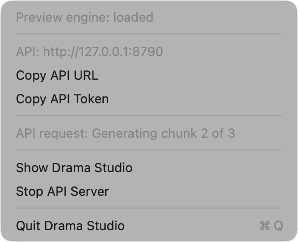

# Drama Studio

A native macOS app that runs Fish Audio's [Drama 3](https://huggingface.co/fishaudio/drama-3)
text-to-speech model locally on Apple silicon. The 35B mixture-of-experts
backbone and the codebook tower run on hand-written Metal compute kernels that
read the released safetensors weights in place. The DAC audio codec runs
through Core ML. No MLX, no PyTorch at runtime.

Built with Fish Audio. The model weights are under the
[Fish Audio Community License](https://huggingface.co/fishaudio/drama-3/blob/main/LICENSE);
cloning a real person's voice without their consent is not permitted.

## What you get

- **Script editor** with import of `.txt`, `.md`, `.rtf`, `.rtfd`, `.html`,
  `.docx`, `.srt` and `.vtt`, drag and drop, and a screenplay mode that turns
  `Name: line` dialogue into Drama 3 speaker tags (up to 16 speakers).
- **Takes**: a New Take button that generates the script again with a fresh
  seed, a Quick preview toggle that skips retries and tightens the frame cap
  for faster rough takes, an Expressiveness slider under Advanced (one control
  over temperature and top-p, with the vendor's defaults in the middle), and an
  insert menu for performance cues such as `[laughs]`, `[sighs]` and
  `<whisper>…</whisper>`. Each chunk's frame cap follows the length of its text.
- **Voice cloning** from one or more reference clips (any format AVFoundation
  reads) plus their transcripts, kept in a local voice library.
- **Streaming playback** as chunks finish, scrubbing, and export to WAV or M4A.
- **A local HTTP API and an MCP server**, so scripts and agents can speak
  through the same engine and voice library (see
  [Agents and programs](#agents-and-programs)).
- **Menu bar residency**: closing the window leaves Drama Studio in the menu
  bar (the waveform-and-microphone icon) with the API still serving. The menu
  shows the model state, the API address, and the current job. ⌘Q quits.

## Requirements

- Apple silicon Mac with plenty of unified memory. The weights are 41.5 GB and
  are mapped, not copied, plus about 2 GB of state and codec; only a 128 GB M3
  Max has been tested.
- macOS 15 or newer, Xcode 26 command line tools.
- The model in the Hugging Face cache:

```bash
uvx --from huggingface_hub hf download fishaudio/drama-3
```

- The Core ML codec models, built once from `codec.pth`:

```bash
cd tools && uv venv --python 3.12 .venv && uv pip install --python .venv/bin/python "torch==2.7.1" coremltools numpy einops soundfile
.venv/bin/python convert_codec.py
```

  They land in `~/Library/Application Support/DramaStudio/Codec/` (encoder
  809 MB in fp32, decoder 353 MB in fp16).

## Build and run

```bash
swift build -c release
tools/make_app.sh            # assembles dist/DramaStudio.app, with drama-mcp in Contents/MacOS
open dist/DramaStudio.app
```

Command line:

```bash
.build/release/drama tune                      # once per Mac, about 30 s; the app does it on first load
.build/release/drama generate --text "Hello there." --out frames.npy
.build/release/drama bench                     # add --untuned to compare against the hand-written schedule
.build/release/drama serve                     # the HTTP API without the app; --port 8780, --no-token
```

`DRAMA_PREVIEW_ENGINE=1` runs the app or `drama serve` on a mock engine that
produces placeholder tones, for working on everything but the model.

## Agents and programs

While Drama Studio is open, including when only its menu bar icon is left, it
serves an HTTP API on `http://127.0.0.1:8780`. `drama serve` serves the same
API without the app. The API listens on the loopback interface only. Settings
holds the port, a switch for starting the server with the app, and the token.
The menu bar has Start and Stop. When the port is taken, the menu shows
"API: Port 8780 is already in use."



Every route except `/v1/health` needs the bearer token from
`~/Library/Application Support/DramaStudio/api-token`, created the first time
the server starts. The token keeps web pages, which can reach localhost, from
driving the engine. `drama serve --no-token` turns it off.

```bash
TOKEN=$(cat ~/Library/Application\ Support/DramaStudio/api-token)
AUTH="Authorization: Bearer $TOKEN"
```

The speech request follows the
[SGLang Drama 3 cookbook](https://sgl-project.github.io/sglang-omni/cookbook/fishaudio_drama3.html):

| Route | Does |
| --- | --- |
| `GET /v1/health` | `{status, model_loaded, engine: "metal" or "mock", busy, tuned, version}`. `tuned` is `null` until the model loads. |
| `GET /v1/models` | The one model, `fishaudio/drama-3`, with its snapshot id. |
| `POST /v1/audio/speech` | Speaks `input`. Returns the audio file, or a PCM stream. |
| `POST /v1/tts` | The same, with the text in `text`. |
| `GET /v1/voices` | The voice library: id, name, transcript, seconds, source file. |
| `POST /v1/voices` | Clones a voice: JSON `{name, transcript, audio_base64 or audio_path}`, or multipart with a `file` part plus `name` and `transcript` fields. |
| `DELETE /v1/voices/{id}` | Deletes a voice. |
| `GET /v1/takes/{id}` | One of the last 20 takes: `{id, input, text, seconds, frames, codes_base64, previous_take_ids}`. |

The speech body takes these fields:

| Field | Meaning |
| --- | --- |
| `input` | The text. Performance cues such as `[laughs]` and `<\|speaker:1\|>` tags work as in the app. |
| `voice` | A library voice, by id or name. |
| `references` | Clips to clone on the fly: `[{audio_path or audio_base64, text}]`. |
| `speaker_voices` | Library voices per speaker for a multi-speaker script: `{"0": "Narrator", "1": "<id>"}`, with no gaps from speaker 0. |
| `response_format` | `wav` (default, 16-bit), `pcm` (raw 16-bit little-endian), or `m4a`. |
| `stream` | `true` streams PCM as each chunk finishes. |
| `expressiveness` | 0 to 1, default 0.5: the app's Expressiveness slider. |
| `quick_preview` | `true` skips retries and tightens the length cap. |
| `seed` | A fixed sampler seed, for repeatable takes. |
| `character` | A voice designed from a description instead of a clip: `{name, description, scene?}`. |
| `note` | A director's note, such as `"softer and warmer"`. The line is generated again as one turn, with the note as a direction and as a cue before every sentence. |
| `previous_takes` | Earlier takes of the line, oldest first: `[{take_id}]` or `[{text, codes_base64}]`. The last two are context. With no `voice` or `references`, the first one is the voice. |

A request takes at most one of `voice`, `references`, `speaker_voices`, and
`character`. Every generation is a take: the response carries its id in
`X-Drama-Take-Id`, and the server keeps the last 20. A `take_id` in
`previous_takes` also brings the takes that take was made after, so naming a
line's latest take carries its first take, the voice. Leave out `input` to
retake the line of the last named take, with its voice and character.
`codes_base64` is the take's codes as 16-bit little-endian integers, codebook
by codebook, as `GET /v1/takes/{id}` returns them.

A file response carries `X-Drama-Frames`, `X-Drama-Seconds`, and
`X-Drama-Generation-Seconds`. The engine runs one generation at a time. A
request that arrives while another runs, through the API or in the window, gets
`429` with `Retry-After`. A bad request gets `400` with a plain-text message
that names the field.

```bash
curl -sS localhost:8780/v1/health
curl -sS -H "$AUTH" localhost:8780/v1/audio/speech \
  -d '{"input": "Hello there. [laughs] Good to see you.", "voice": "Narrator"}' -o hello.wav
curl -sS -H "$AUTH" localhost:8780/v1/tts -d '{"text": "The alias route."}' -o alias.wav
curl -sS -H "$AUTH" localhost:8780/v1/audio/speech \
  -d '{"input": "Cloned on the fly.", "references": [{"audio_path": "/path/to/clip.wav", "text": "What the clip says."}]}' -o clone.wav
curl -sS -H "$AUTH" -D headers.txt localhost:8780/v1/audio/speech \
  -d '{"input": "[low and menacing] Pray ye never find out.", "character": {"name": "Captain", "description": "gravelly old male voice, weathered and slow"}}' -o captain.wav
TAKE=$(awk 'tolower($1) == "x-drama-take-id:" {print $2}' headers.txt | tr -d '\r')
curl -sS -H "$AUTH" localhost:8780/v1/audio/speech \
  -d "{\"note\": \"softer and warmer\", \"previous_takes\": [{\"take_id\": \"$TAKE\"}]}" -o captain-retake.wav
```

Streaming sends `Transfer-Encoding: chunked` with one HTTP chunk per generated
chunk. The audio is 16-bit little-endian mono at 44.1 kHz, as the
`X-Drama-Format: pcm_s16le_mono` and `X-Drama-Sample-Rate: 44100` headers say.
Pipe it into a player to hear the first sentence while the rest generates:

```bash
curl -sSN -H "$AUTH" localhost:8780/v1/audio/speech \
  -d '{"input": "A long script, read as it is generated.", "stream": true, "response_format": "pcm"}' |
  ffplay -f s16le -ar 44100 -ch_layout mono -nodisp -autoexit -
```

Manage voices:

```bash
curl -sS -H "$AUTH" localhost:8780/v1/voices
curl -sS -H "$AUTH" localhost:8780/v1/voices -F file=@clip.wav -F name=Narrator -F "transcript=What the clip says."
curl -sS -H "$AUTH" -X DELETE localhost:8780/v1/voices/<id>
```

`tools/api_smoke.sh [base-url]` runs all of the above against a running server
and checks each answer.

### MCP

`drama-mcp` is an MCP server over stdio (protocol 2025-06-18) that calls the
HTTP API. `tools/make_app.sh` puts it at
`DramaStudio.app/Contents/MacOS/drama-mcp`; `swift build` puts it at
`.build/debug/drama-mcp`. When nothing answers, it opens Drama Studio and waits
up to 90 seconds for `/v1/health`. It looks for the app in `DRAMA_APP_PATH`,
then the app that contains it, then `/Applications/DramaStudio.app`, then the
repository's `dist/DramaStudio.app`. `DRAMA_API_URL` overrides
`http://127.0.0.1:8780`. It reads the token from the same file.

| Tool | Does |
| --- | --- |
| `synthesize_speech` | `text`, with optional `voice` or `character` (`{name, description, scene?}`), `output_path`, `expressiveness`, `quick_preview`, and `play`. Writes a WAV, by default to `~/Library/Application Support/DramaStudio/Output/<timestamp>.wav`. Returns the path, seconds, frames, generation seconds, and `take_id`. `play` plays it with `afplay`. |
| `retake_with_note` | `take_id` and `note`, with optional `output_path` and `play`. Generates that take's line again in the same voice with the note. Returns what `synthesize_speech` returns, with the new `take_id`. |
| `list_voices` | The voice library. |
| `add_voice` | Clones `audio_path` with its `transcript` under `name`. |
| `delete_voice` | Deletes a voice by `id`. |
| `studio_status` | Health, the model snapshot, and the API address. |

Register it with Claude Code:

```bash
claude mcp add drama-studio -- /Applications/DramaStudio.app/Contents/MacOS/drama-mcp
```

Or with Claude Desktop, in `~/Library/Application Support/Claude/claude_desktop_config.json`:

```json
{
  "mcpServers": {
    "drama-studio": {
      "command": "/Applications/DramaStudio.app/Contents/MacOS/drama-mcp"
    }
  }
}
```

## How it is built

- `Sources/DramaEngine/Weights`: the eight safetensors shards are memory-mapped
  (`MAP_SHARED`) and wrapped as Metal buffers without copying. Experts stay in
  FP8 E4M3 with their 128x128 block scales and are decoded inside the kernel
  through a 256-entry table; every other weight is bf16 widened to fp32 in the
  kernel.
- `Sources/DramaEngine/Kernels`: zero-centered RMSNorm, a bf16 GEMV for decode
  and a simdgroup-matrix GEMM for prefill, the Gated DeltaNet depthwise conv and
  recurrence, GQA attention with an online softmax over an fp32 KV cache,
  partial RoPE (NeoX for the backbone, interleaved for the tower), the MoE
  router and expert-major FP8 kernels that dispatch only over active experts
  (one-row kernels for decode, tiled simdgroup-matrix kernels for prefill),
  the GPU sampler, and the codebook tower's embedding mixing. Tile shapes,
  threadgroup sizes and the attention key split are fields of a
  `KernelSchedule` that `Autotune` fills per machine (see below).
- `Sources/DramaEngine/Model`: the backbone and tower runners, the reference's
  sampler (top-k, top-p, exponential-noise argmax, repetition-aware retry of the
  main token) on the CPU and as Metal kernels that reproduce its picks and
  generator stream bit for bit, prefill and decode sessions, and the chunked
  frame generator. A decode frame is one command buffer, with the next frame's
  buffer committed before the current one is waited for.
- `Sources/DramaEngine/Prompt`: the `reference-bracket-v1` prompt builder, the
  reference's chunker and history policy, plus a sentence-per-turn mode.
- `Sources/DramaEngine/Tokenizer`: a byte-level BPE tokenizer that matches
  Hugging Face `tokenizers` on a 661-case corpus.
- `Sources/DramaEngine/Codec`: Core ML wrappers for the DAC encoder (reference
  clips to codes) and decoder (codes to 44.1 kHz audio), both exported at one
  static 512-frame shape and run in windows with 256 frames of left context.
- `Sources/DramaServer`: the HTTP API on `Network.framework`. Request parsing
  and routing are pure functions from an `HTTPRequest` to an `APIRequest`;
  `APIService` answers them against any `SpeechSynthesizer` and `VoiceStore`,
  so the app, `drama serve`, and the tests share it.
- `Sources/DramaMCP` and `Sources/drama-mcp`: the MCP server, JSON-RPC 2.0
  over stdio, proxying the HTTP API.
- `App/DramaStudio`: the SwiftUI app, with the API server and the menu bar
  extra in `App/DramaStudio/Server`.
- `eval/`: the faithfulness suite (see `docs/EVAL.md`).

Design notes and decisions are in `docs/DESIGN.md`; the decision trail of the
build is `.audit/drama-studio.tsv`.

## Faithfulness

The engine is checked against the fish-speech v3.0.0-beta PyTorch
implementation running on the CPU in float32, teacher-forced on the same
prompt and frames. Numbers from `eval/compare.py`:

| quantity | relative L2 vs float32 oracle | top-1 agreement | mean KL |
| --- | --- | --- | --- |
| backbone hidden state, 121 positions (worst position 1.3e-6) | 5.7e-7 | | |
| main-token candidate logits | 3.0e-7 | 1.000 | 1.3e-12 |
| nine tower head logits | 4.4e-7 | 1.000 | 4.2e-12 |
| residual stream after each of the 40 layers, and each of the 13 tower layers, at the first step | under 2e-6 each | | |

For scale, the same oracle run in bfloat16 on the CPU differs from its float32
run by a relative L2 of 5.2e-2 on the hidden state with a top-1 agreement of
0.846. The Metal engine sits at float32 precision; it keeps the FP8 expert
weights exact and widens everything else, so it does not reproduce the
CUDA release's W8A8 activation quantization, and no claim is made about that.

The sampler is checked separately: over 1174 sampled picks, none falls outside
the reference's top-k / top-p set, and the count of rank-0 picks matches the
expected value within noise.

End-to-end, the sentences the model does speak transcribe cleanly under
Whisper, but with the reference's chunking it often stops after the first
sentence of a two-sentence prompt or trails into silence, and the reference
PyTorch implementation does the same on the same text and seeds. The
sentence-per-turn mode and the retry rule below exist for that reason.
See `eval/README.md` for how to reproduce every number.

## The Neural Engine, honestly

The codec goes through Core ML because Core ML is the only route to the
Neural Engine. On this machine (macOS 26.5, M3 Max) that route did not pay off:

- The decoder's Neural Engine compile for the 512-frame shape ran for more than
  35 minutes without finishing; the 64-frame shape compiled in about 7 minutes
  and then ran three times slower on the ANE than on the CPU, because the
  compute plan puts 72 percent of the decoder's cost (long-sequence
  convolutions and the Snake activation's `sin` after upsampling) on the CPU
  anyway.
- The ANE's native transposed convolution lost about 15 dB of accuracy, so the
  export rewrites transposed convolutions as polyphase convolutions.
- The GPU path returns wrong audio for the chained residual units of the last
  decoder block (about 5 dB SNR); each unit alone is correct, which points at
  op fusion, though the cause was not isolated.
- Core ML's enumerated shapes crash the CPU backend (SIGTRAP) on multi-channel
  convolutions here, so the models use one static shape.

So the shipped configuration runs the encoder in fp32 and the decoder in fp16
on the CPU through Core ML: 1.5 s per 512-frame window (23.8 s of audio) for
the decoder and 2.1 s for a 10 s reference clip in the encoder. The encoder
matches PyTorch's codes exactly; the decoder is 35 to 39 dB from the fp32
reference. `DramaCodec.init(computeUnits:)` still accepts `.cpuAndNeuralEngine`
for anyone who wants to retry on a different machine or OS.

## Speech quality hill-climb

Measured with `eval/e2e.py` on six texts, plain and cloned, three seeds each
(36 runs per row), scored by Whisper small.en word error rate, whether the model
reached eos, trailing silent frames, and resemblyzer speaker similarity to the
reference clip for the cloned runs.

| configuration | mean WER | runs at or under 0.1 WER | eos reached | mean quiet tail | speaker similarity |
| --- | --- | --- | --- | --- | --- |
| reference chunking (300 bytes), no probe | 0.141 | 69% | 89% | 103 frames | 0.867 |
| one sentence per turn | 0.063 | 86% | 100% | 30 frames | 0.867 |
| sentence per turn, silence stop, short-chunk retry (shipped defaults) | 0.016 | 92% | 100% | 2 frames | 0.867 |

The app now fixes the chunking and retry policies at the shipped defaults; the
`drama` CLI still reaches them through `--chunking`, `--no-retry` and
`--max-frames`.

Uncloned outputs score 0.54 to 0.56 against the reference clip, so the cloned
0.87 is the voice carrying over, not the metric's floor. The only misses in the
last row are Whisper rendering "the 21st of March" as "21 March" in three runs;
every other run transcribes exactly. The retry rule's threshold was chosen on
the same 72 runs of the first two rows and then applied to the third, so treat
it as tuned to this sentence set. The word error rates above use the PyTorch
codec to decode. Decoding the same 36 frame sequences with the shipped Core ML
fp16 decoder instead (`eval/coreml_vs_pytorch_wer.py`) gives the same mean
word error rate, 0.063 against 0.063, with no run scoring worse.

## Performance (M3 Max, 128 GB)

Medians of five interleaved runs against the previous engine on an idle
machine (`eval/perf_ab.sh`, raw runs under `eval/out/perf/ab_final/`). GPU
times come from `drama bench`; the end-to-end rows are wall time from
`drama generate --warm` on a 324-row prompt (a 10 s reference clip plus text)
and 600 frames.

| step | before | now |
| --- | --- | --- |
| weights mapped and kernels compiled | 0.4 to 0.7 s | 0.4 to 0.7 s |
| warm-up (page walk, pipelines, first command buffer) | 4 s cold, then a 0.37 s first forward | 4 s cold; the first forward then costs 0.05 s |
| backbone prefill, 128 rows | 647 ms GPU | 213 ms GPU |
| tower prefill, 128 rows | 171 ms GPU | 38 ms GPU |
| backbone plus tower prefill, 300 rows in one chunk | three 128-row chunks | 382 plus 93 ms GPU |
| end-to-end prefill of a 324-row prompt | 2.44 s | 0.72 s |
| backbone decode, one frame | 17 to 18 ms GPU | 17 to 18 ms GPU |
| tower decode, one frame | 6.7 ms GPU | 6.7 ms GPU |
| decode, one frame | ten command buffers, sampling on the CPU between tower layers | one command buffer, 25.6 to 27.0 ms GPU, the next frame's buffer committed before the current one is waited for |
| end-to-end decode | 31.5 frames/s (range 28.7 to 31.6) | 38.5 frames/s (range 37.0 to 39.1), 1.8x real time |

Prefill runs dense projections through a simdgroup-matrix GEMM and the FP8
experts through tiled kernels that dequantize each weight tile once; at 128
rows nearly every expert is active, so a chunk reads all 30 GB of expert
weights once and the chunk is 512 rows so a 10 s reference clip is one pass.
Small chunks pay for that choice: an 8-row chunk takes 66 ms instead of 42,
because one tile shape serves every row count so that a row's result is the
same in any chunk (the prefix cache depends on it). Decode is bound by weight
bandwidth: the one-row backbone forward reads about 3.4 GB of weights in 17
to 18 ms, about 200 GB/s averaged over its 600 small dispatches, and the
`no-experts` bench delta puts the eight active experts at about 250 GB/s.
`drama profile --rows N` prints the GPU time of each kernel group on the real
weights (one layer repeated, so its numbers can be cache-warm), and
`drama kbench` times the GEMM tile shapes and the expert kernels on synthetic
data. The before column comes from the same session as the now column; the
same baseline binary measured 583 to 586 ms for the 128-row prefill in two
earlier series that day, so day-to-day drift of about 10 percent is normal.

The kernel changes keep every fp32 product and change only summation orders;
the faithfulness table above is from the new engine (hidden 5.7e-7, candidate
logits 3.0e-7, tower logits 4.4e-7 relative L2, top-1 1.0; it was 6.5e-7,
3.3e-7 and 5.0e-7 before). The GPU sampler reproduces the CPU sampler's picks
and generator stream: 160,000 chained picks identical in the long parity run
on the pre-merge code (`DRAMA_SAMPLER_PARITY_SAMPLES=20000`), 16,000 in the
default run on the merged code, and every generation compared between the
CPU and GPU samplers on the previous kernels produced the same frames.
Reordered sums do change the result on some prompts: in the end-to-end suite
28 of 36 runs produced the same frames as before, one differed only in where
the codec silence probe stopped it, and 7 differed deterministically, with
the summary metrics unchanged (mean word error rate 0.016 in both, eos
reached in all runs, speaker similarity 0.870 against 0.867). On the one such
prompt examined (`eval/specs/qshort.json`), the two engines agree to 2e-7
through layer 29 and part at layer 35, the shape of a discrete routing change
on a near-tie (the router ids themselves were not dumped). A fresh float32
oracle dump of that prompt takes the new engine's side: 9.5e-7 on the hidden
state, where the previous engine was off by 3.9e-3 and failed the suite's
thresholds. That holds for this one prompt only; the faithfulness gate above
runs on a single prompt and would not catch the same kind of divergence on
another.

## Kernel autotune

Kernel schedule parameters (the GEMV token tile and rows per threadgroup, the
GEMM tile, the MoE tile and K step, the one-row expert kernels' rows per
threadgroup, the attention key split, the GDN threads per state column) are
not constants any more. On the first load for a given (chip, macOS version,
kernel source digest, model snapshot) the engine times each kernel family's
real workload on the resident weights, rotated over ten layers, for every
value in its declared domain, keeps a candidate only when its output is within
a relative L2 of 1e-5 of the default's on the same inputs and it is at least 5
percent faster over five interleaved rounds, then times whole forwards of 128
and 300 rows and of one row on both schedules and drops a side's choices
unless the tuned one wins by 2 percent at every row count. The result is a
JSON report under `~/Library/Application Support/DramaStudio/Tuning/`; every
later load reads it and measures nothing. `drama tune` runs it from the
command line and prints the table (about 30 s here); the app shows "Tuning
kernels for this Mac" once; `drama schedule-ab` times any two schedule files
against each other inside one process. The idea is Magnitude's (tune,
validate, cache per device); the kernels, the domains and the harness are
this project's. Nothing in the numerics changes beyond summation order: the
tuned engine scores hidden 5.8e-7, candidate logits 3.0e-7 and tower logits
4.4e-7 against the float32 oracle with top-1 1.0 (`eval/out/perf/compare_tuned_final.txt`),
and the A/B prompt below produced byte-identical frames with and without the
tuned schedule in all fourteen compared runs.

What it shipped on this M3 Max (`eval/out/perf/tune_final2.txt`): two decode
changes, a token tile of 1 with two simdgroups per threadgroup for the one-row
GEMVs (27 percent faster per kernel) and a 16-way key split for one-row
attention (27 percent). Everything on the prefill side stayed at the
hand-picked values: the GEMM tile, the MoE tile and the GDN split never
cleared the 5 percent bar, and the narrow-projection GEMV tile and the 4-way
prefill attention split, 80 and 5 percent faster per kernel, moved the whole
128- and 300-row forwards by 1.2 and 0.4 percent, under the margin, so the
whole-forward check reverted them. Two earlier versions of the harness would
have shipped a slower prefill: random activations route evenly over the 256
experts and favour a small MoE row tile that was 9 percent faster on the
harness and 5 to 12 percent slower in the real prefill, and a 2 percent
minimum gain measured at 128 and 32 rows let through a tile that lost 9
percent at 300 rows. Both are in `.audit/autotune.tsv`, and the isolation
that caught the second is `eval/out/perf/schedule_ab_1.txt`.

Measured, with the shipped schedule against the default:

| measurement | untuned | tuned |
| --- | --- | --- |
| backbone forward, one row, GPU, `drama schedule-ab` in one process, 7 interleaved rounds | 19.2 ms [18.4..19.5] | 15.3 ms [14.8..15.5], faster in 7 of 7 |
| same, `drama bench` in separate processes, two five-run series | 18.0 [17.2..18.3], 17.9 [17.5..18.2] | 15.1 [14.7..15.8], 15.4 [14.8..16.7] |
| tower decode, one row, GPU, `drama bench` | 6.9, 6.8 ms | 6.1, 6.2 ms |
| end-to-end decode, 425 frames after a 324-row prompt, `drama generate`, five-run medians | 32.9 [15.0..37.1], 29.7 [21.8..33.1] frames/s | 33.5 [14.9..42.2], 35.1 [32.3..36.8] frames/s |
| same, GPU ms per frame, the three rounds of the first series where neither side was disturbed, then all five of the second | 26.9, 27.9, 30.4; 46.0, 34.6, 32.9, 33.7, 30.2 | 24.6, 23.7, 29.8; 31.0, 28.5, 27.2, 27.7, 29.7 |
| backbone prefill, 128 and 300 rows | unchanged: the shipped schedule runs the same kernels (`schedule-ab` 196.9 against 201.0 and 382.9 against 382.0 ms, the instrument's own spread) | |

The one-row forward is the solid number: about 20 percent less GPU time in
four series (the two bench series, the in-process A/B and the tuner's own
check at 17.1 against 14.6 ms), ranges not overlapping, from the decode GEMV
tile and the attention split, both of which put more and smaller threadgroups
on the same bytes. The end-to-end frames-per-second rows are softer: the two
`drama generate` series ran on a machine that was not idle (other sessions'
test jobs and the window server busy; load average 4.8 to 12), their ranges
are wide, and in the first series two of five rounds were disturbed on both
sides for a reason the load averages do not show, so the five-run medians
move only 2 and 18 percent while the per-frame GPU time is lower on the tuned
side in every round where neither side was disturbed. Those two series ran
with an earlier cache whose decode fields equal the shipped ones and whose
prefill fields have since been reverted. Prefill has no measured change and
none is expected: with the reverted fields the schedule is the default there.
To redo the end-to-end table on an idle machine: `eval/tune_ab.sh
.build/release/drama 5 eval/out/perf/ab_tune_idle` then
`eval/.venv/bin/python -I eval/perf_ab_summary.py eval/out/perf/ab_tune_idle`.

## Licenses

The app code is MIT. The vendored reference code under `eval/oracle/` and the
model weights are under the Fish Audio Community License; see
`eval/oracle/LICENSE_NOTE.md`.
